# Zamin OS

**Dasturçi:** Abbosjon Dev · **Veb-sayt:** [zamin.app](https://zamin.app) · **Email:** [info@zamin.app](mailto:info@zamin.app)

Rust tilida **noldan** yozilayotgan, **ARM64 (AArch64)** protsessorlari uçun operatsion tizim.
Öz ğoyalarimiz asosida: toza dizayn, mikroyadroga yaqin arxitektura, silliq interfeys. Boşqa tizimlardan kod, nom yoki dizayn köçirilmaydi.

**Asosiy qoida:** heç qanday taşqi crate yoki boşqa OS kodi işlatilmaydi — `Cargo.toml` dagi
`[dependencies]` böş. Faqat Rust kompilyatori va `core` kutubxonasi.

## Ekran koʻrinişi

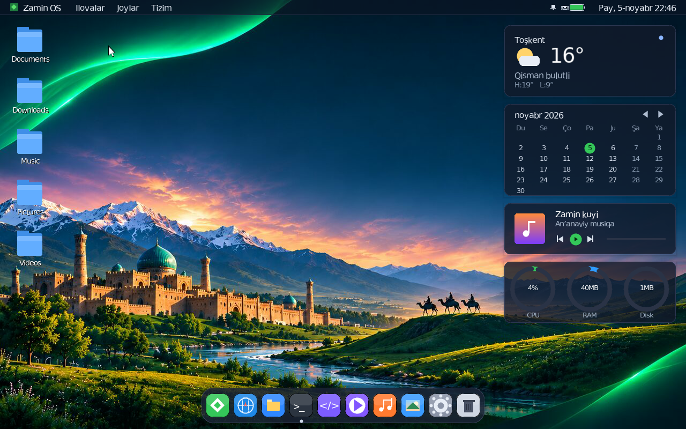

To'liq grafik ish stoli (virtio-gpu): yuqori menyu paneli, rangli dok, va oʻng
tomonda vidjetlar — ob-havo, kalendar, musiqa pleeri va tizim halqalari
(CPU/RAM/Disk). Fon rasmi OS ning **öz JPEG dekoderi** bilan chiziladi.

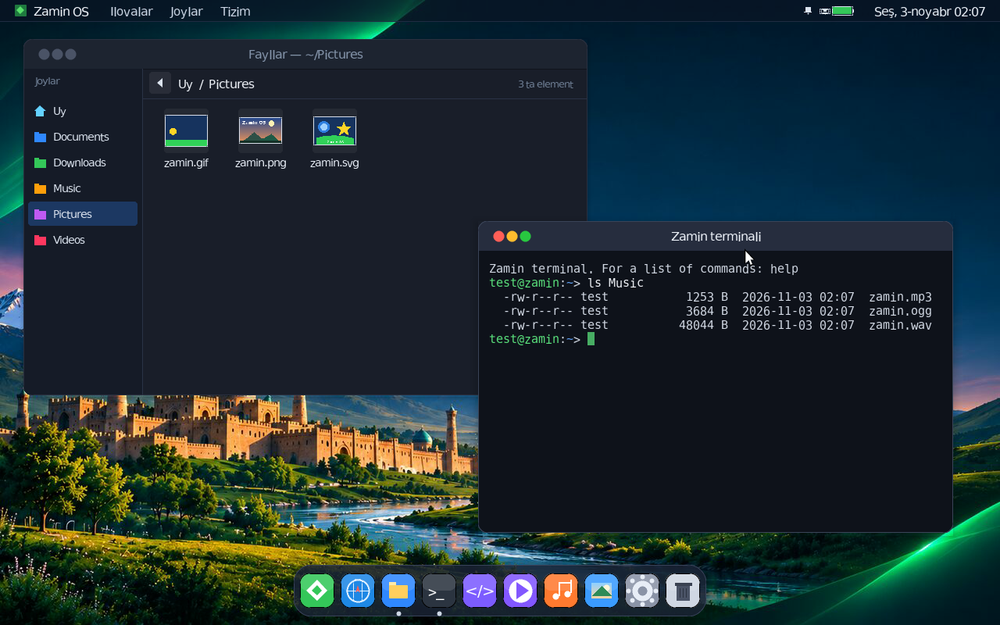

### Menyular va interaktiv vidjetlar

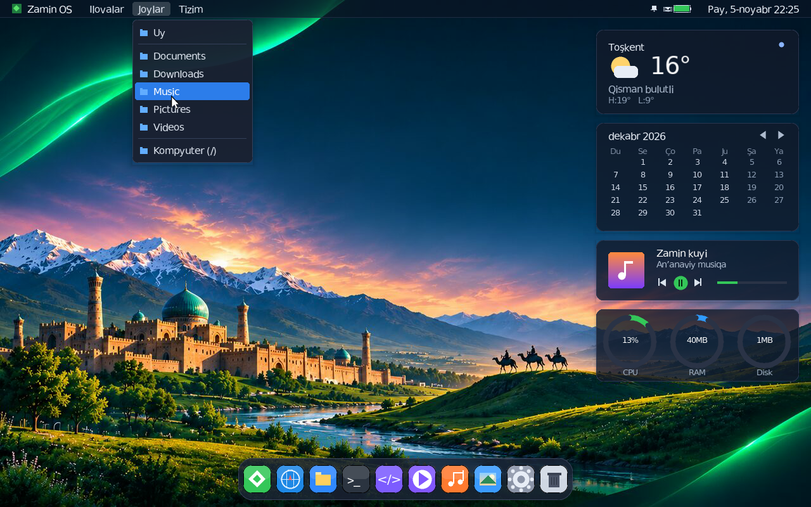

- **Ilovalar / Joylar / Tizim** — oçiladigan menyular (siçqon ostidagi band ajratiladi,
  Esc yopadi). *Joylar* uy papkalarini Fayllar oynasida oçadi; *Tizim* — haqida,
  sozlamalar, **qayta yuklaş** va **öçiriş** (avval diskka saqlanadi).
- **Kalendar** — ‹ › bilan oylar almaşadi (sarlavhani bosiş — bugungi oyga qaytiş).
- **Pleer** — haqiqiy kuyni (MP3, öz dekoderimiz) chaladi: ijro/pauza, boşiga, progress.
- **Tizim halqalari haqiqiy:** CPU — rejalaştiruvçi har uzilişda band/böş vazifani
  sanaydi; RAM — fizik sahifalar; Disk — ZaminFS band bloklari.

### Oyna boshqaruvi

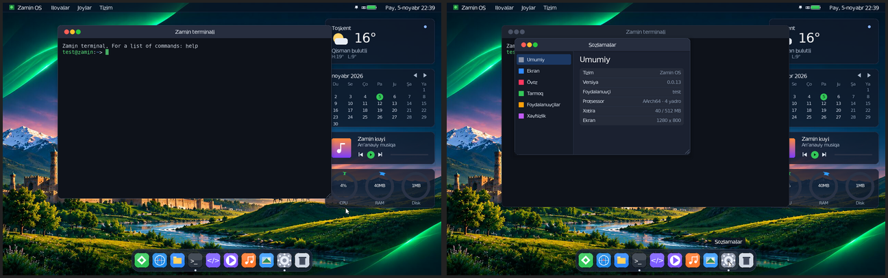

- 🔴 **yopiş**, 🟡 **dokka yashiriş**, 🟢 **butun ekranga kattalashtiriş** (yana bosilsa —
  oldingi ölçam). Siçqon tugmalar ustida bölganda macOS kabi `× − +` belgilari chiqadi.
- Sarlavhadan sudrab **siljitiş**, öng-pastki burçakdan sudrab **ölçamni özgartiriş**
  (mazmun — Fayllar grid, terminal satrlari, rasm — yangi ölçamga moslaşadi).
- Dokdagi ikona: ilova oçiq bölsa (yashirilgan ham) — oynani old planga qaytaradi,
  bölmasa — yangi oçadi. Ostidagi nuqta oçiq ilovani bildiradi.

### Ish stoli ikonalari va animatsiyalar

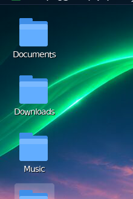

Ish stolining çap tomonida uy papkalari (Hujjatlar, Yuklamalar, Musiqa, Rasmlar,
Videolar) ikonalari: **bir marta bosiş — tanlaş**, **ikki marta — Fayllarda oçiş**.

Oynalar **animatsiya** bilan: yangi oyna dok ikonasidan kattalaşib çiqadi, yashirilganda
dokka "uçib" kiradi, kattalaştiriş/qaytariş silliq oʻtadi (easeOutCubic, 230 ms).
Quyidagi kadrlar animatsiya sekinlaştirilgan holda olingan:

<br clear="left">

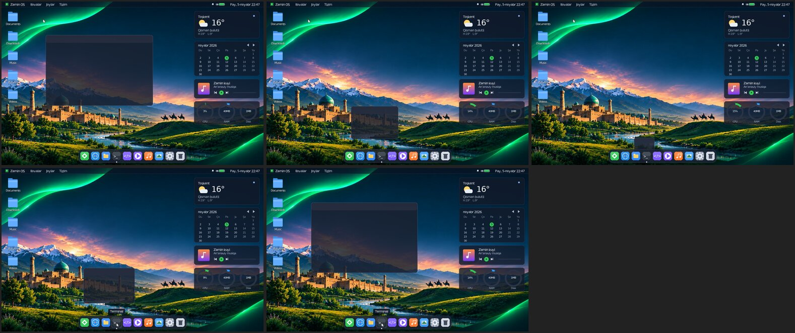

### Sozlamalar: fon rasmi va asosiy rang

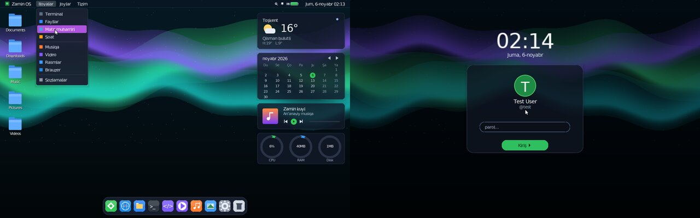

Sozlamalar → **Ekran**: 4 ta fon (Zamin manzarasi — foto; **Tun**, **Aurora**, **Şafaq** —
OS içida protsedural chiziladi, istalgan ekran ölçamida) va 6 ta **asosiy rang**
(menyu, qidiruv, yon panellar, tanlovlar uçun). Tanlov darhol qöllanadi, **diskka
saqlanadi** (`fon=`, `rang=`) va qayta yuklaşdan keyin ham — qulf ekranida ham — qoladi.

Boşqa bölimlar haqiqiy tizim maʼlumotini körsatadi: **Tarmoq** (virtio-net, DHCP, IP,
şlyuz, DNS, MAC), **Övoz** (qurilma va dekoderlar), **Foydalanuvçilar**, **Xavfsizlik**
(W^X, PAN, KASLR, disk şifrlaş…), **Umumiy** (versiya, xotira, ish vaqti).

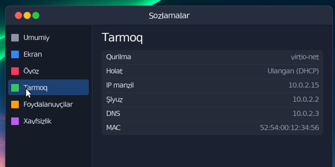

**Övoz balandligi va övozsiz rejim.** Sozlamalar → **Övoz** bölimida sudraladigan
slayder (0–100 %, foiz körsatkiçi bilan) va **"Övozsiz"** tugmasi bor. Daraja global:
musiqa pleeri, brauzerdagi `<audio>` va ish stolidagi pleer vidjeti — barçasi
virtio-sound ga yuborilişidan oldin PCM namunalarini şu darajaga köpaytiradi
(Q16 fixed-point, yaxlitlab, i16 çegarasida qirqiladi). Daraja har bir davr (period)
uçun qayta öqiladi, şuning uçun ijro paytida ham darhol eşitiladi. Yuqori menyu
panelida karnay belgisi bor (daraja böyiça 1–3 tölqin; övozsiz bölsa ustidan qizil
çiziq) — unga bosiş övozsiz rejimni yoqadi/öçiradi. Sozlama diskka saqlanadi
(`ovoz=`, `ovozsiz=`) va qayta yuklaşda tiklanadi. Self-test: `[ok] övoz balandligi`
(100 % da özgarmaydi, 50 % da ±1 aniqlikda yarmi, 0 % va övozsizda nol, toşiş yöq).

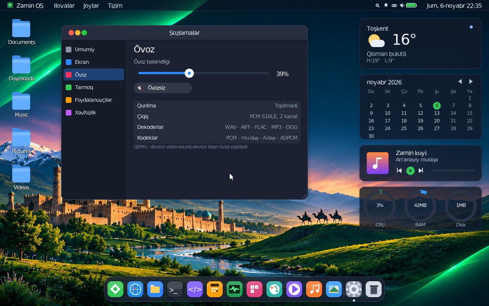

### Kontekst menyulari va öz rasmingiz fonda

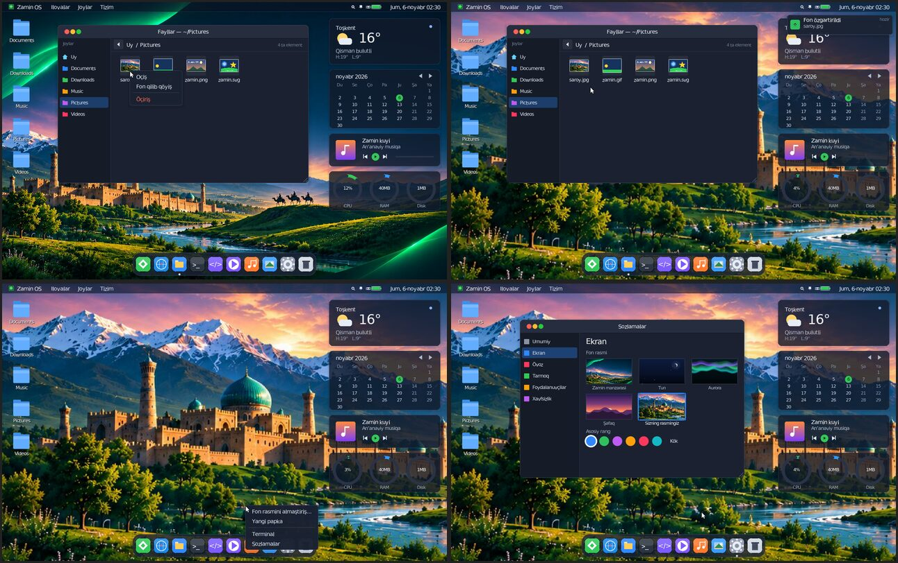

Siçqonning **öng tugmasi**:
- **Fayllarda rasm ustida** — Oçiş, **Fon qilib qöyiş**, Öçiriş; papka ustida — Oçiş, Öçiriş;
  boʻş joyda — Yangi papka, Yangilaş.
- **Ish stolida** — Fon rasmini almaştiriş… (Sozlamalar → Ekran), Yangi papka, Terminal,
  Sozlamalar; ish stoli ikonasi ustida — Oçiş.

Tanlangan rasm ekranni toʻliq qoplaydigan qilib kesiladi ("cover"), yöli diskka
saqlanadi (`fon_yol=`) va Sozlamalarda 5-variant — **"Sizning rasmingiz"** bölib çiqadi.
(Qulf ekranida — foydalanuvçi fayllari hali şifrlangan bölgani uçun — asosiy foto
körsatiladi.) Rasm eskizlari keşlanadi: papka qayta yuklanganda qayta dekodlanmaydi.

### Fayl boshqaruvi va Savat

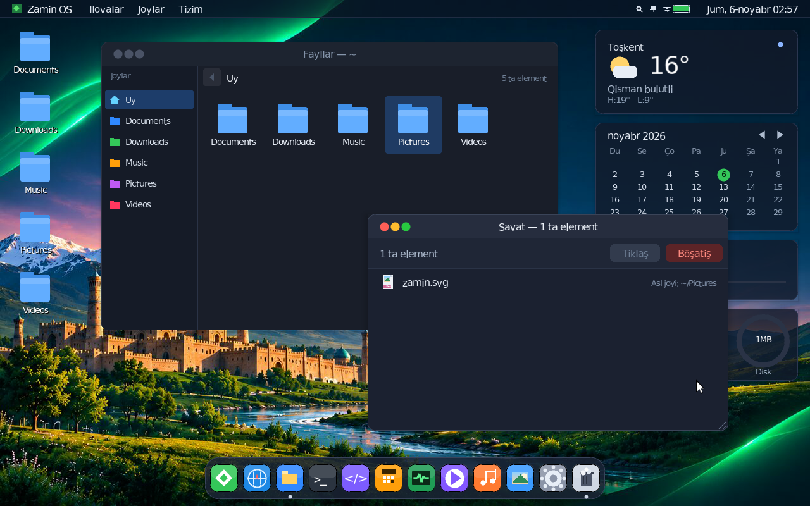

- **Bir marta bosiş — tanlaş, ikki marta — oçiş**; strelkalar bilan yuriş, `Enter` — oçiş,
  `Backspace` — ota papka.
- **`F2` (yoki öng tugma → Nomini özgartiriş)** — joyida tahrirlanadigan nom maydoni
  (`Enter` — saqlaş, `Esc` — bekor). Fayl tizimida yangi `fs::rename` — maʼlumot
  nusxalanmaydi, tugun yangi joyga ulanadi.
- **Nusxa olish / Kesiş / Joylaş** — `Alt+C`, `Alt+X`, `Alt+V` yoki kontekst menyusi;
  papkalar içidagilari bilan nusxalanadi, band nom bölsa `nom (2).txt`.
- **Haqiqiy Savat** — `Delete` yoki "Savatga tashlaş": fayl `~/.Savat` ga köçadi, asl
  joyi `~/.Savat/.joylar` indeksida saqlanadi. Savat oynasida **Tiklaş** (asl joyiga,
  papka yöq bölsa — uyga) va **Böşatiş**; dokdagi savat töla bölsa — qogʻozlar körinadi.
  Nuqta bilan boşlanadigan yaşirin fayllar körsatilmaydi.

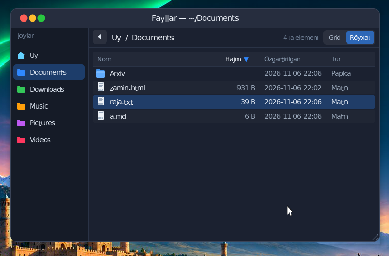

- **Grid / Röyxat almaştirgiçi** (asboblar qatorining öng tomonida). Röyxat körinişida
  kiçik ikona (rasmlar uçun eskiz), **Nom**, **Hajm** (`B` / `KB` / `MB` / `GB`, papka uçun
  `—`), **Özgartirilgan** sana (fayl tizimidagi `mtime`, mahalliy vaqtda — standart Toşkent,
  UTC+5) va **Tur** (Papka, Rasm, Matn, Övoz, Video, Arxiv, Dastur yoki `KENGAYTMA fayl`).
- **Ustun sarlavhasini bosiş** — şu ustun böyiça saralaydi, yana bosiş — tartibni teskari
  qiladi (`▲` / `▼` belgisi). Papkalar doim yuqorida turadi, teng qiymatlar nom böyiça.
  Saralaş özgarganda tanlangan element nom böyiça saqlanib qoladi.
- Tanlaş, ikki marta bosiş, strelkalar, `Enter`, `F2`, `Delete`, sudrab tashlaş (papka
  qatoriga) va kontekst menyusi röyxatda ham xuddi griddagidek işlaydi.
- Tanlangan körinış va saralaş `~/.zamin/files` ga saqlanadi
  (`view=list sort=size desc=1`) — qayta yuklanişdan keyin ham qoladi.
- Mantiq sof funksiyalarda: `sort_entries(entries, key, desc)` va `human_size(u64)`;
  yuklanişda `[ok] fayllar saralaş` self-testi nom/hajm/sana böyiça teskari tartibni,
  papkalar birinçi turişini va `human_size(0 / 1023 / 1024 / 5 MB)` ni tekşiradi.

### Brauzer: to'liq HTML (`zamin://html` sinov sahifasi)

| Matn teglari va belgilar | Ro'yxatlar (A./iv./teskari), ichma-ich belgilar |
|---|---|
| 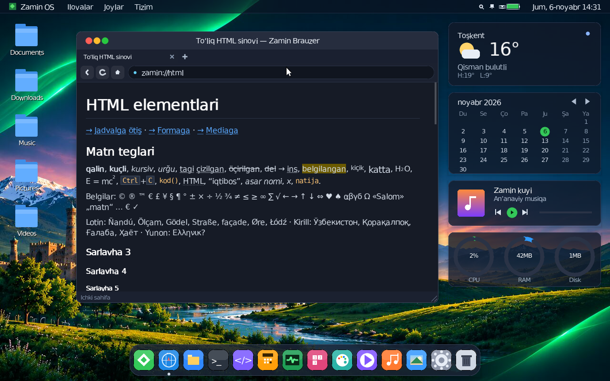 | 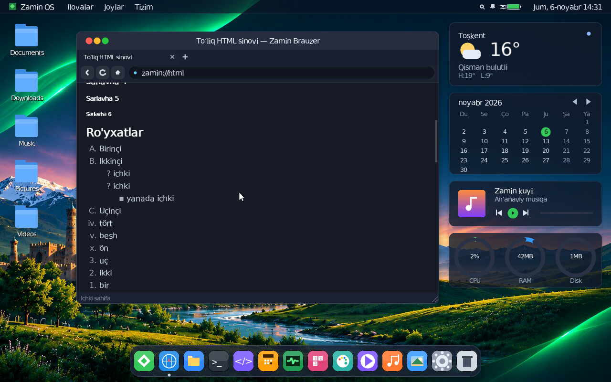 |
| **Jadval: caption, thead, border, colspan** | **Forma: label, radio, range, color, progress, meter** |
| 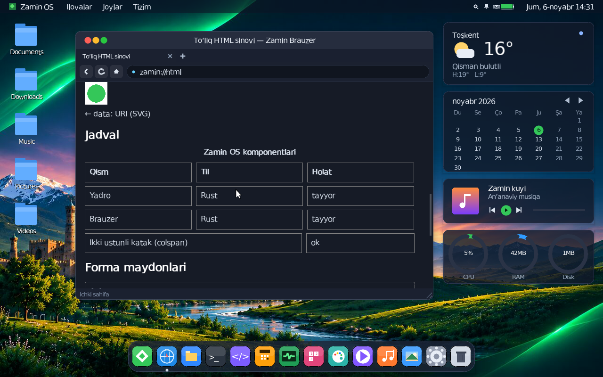 | 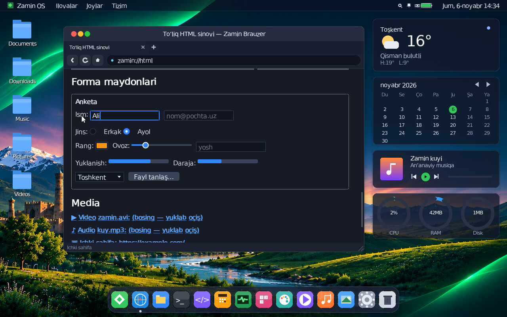 |

- **Matn**: haqiqiy **qalin** (ikki marta chizish), *kursiv* (tasmali qiyalik), `u/ins`, `s/del`,
  `mark`, `small/big`, `sub/sup` (tayanch chiziq bo'yicha), `kbd` ramkasi, `abbr` (nuqtali),
  `q` (qo'shtirnoq), `cite/var/dfn/address`, `font size/color`; CSS `line-through`, `font-style`.
- **Bloklar**: `h1`–`h6`, `dl/dt/dd`, `ol type="1|a|A|i|I"` + `start`/`reversed`/`li value`,
  ichma-ich `ul` belgilari (• ◦ ▪), `figure/figcaption`, `fieldset/legend`,
  **`details/summary`** (bosilsa ochiladi), `<a name>` va **`#yakor`** havolalari.
- **Jadvallar**: `caption`, `thead/tbody/tfoot`, `table border`, `cellpadding`, `colspan`, `rowspan`, `td width`.
  `rowspan` — katak pastki qatorlarga çoziladi (ramkasi birlaşadi), keyingi qatorlarda uning ustuni
  böş joy egallovçi bilan saqlanadi; yuklaniş self-testida tekşiriladi.
- **Media**: `img width/height`, `srcset`, `picture/source`, lazy `data-src`, **`data:` URI**
  (base64 va URL-kodlangan), **ichki `<svg>`** (SVG dekoderimiz bilan), **`<audio>` ijrosi va `<video poster>`** (pastda), `embed/object` va boshqa
  manbali `iframe` kartochkalari (havola orqali yuklab olinadi), **`<iframe>` ichki hujjatlari** (pastda), **`<canvas>` 2D** (pastda).
- **Formalar**: `radio` guruhlari, `label for` va o'rab turgan `label`, `email/number/date/url/tel/search`,
  `color`, `range`, `file`, `progress`, `meter`, `optgroup`.
- **Hujjat**: `<base href>`, `<meta http-equiv=refresh>`, kodlashlar: UTF-8, **windows-1251**,
  latin-1/windows-1252 (`Content-Type` yoki `<meta charset>`), ~250 ta nomli belgi (`&euro;`,
  `&rarr;`, `&alpha;`…, Latin-1 harflari).
- **Shrift**: 170 → **686 belgi** (Latin-1/Extended-A, o'zbek kirill Ўў Ққ Ғғ Ҳҳ, ʻ, yunon,
  tipografiya, strelkalar, matematika, shakllar); glif qidirish — saralangan jadvalda ikkilik qidiruv.

### Brauzer: flex, grid, jadvallar, async/await va tablar

| Flex (yonma-yon kartalar), grid, jadval | async/await, appendChild, classList |
|---|---|
| 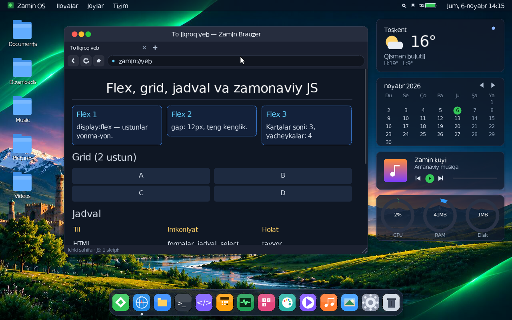 | 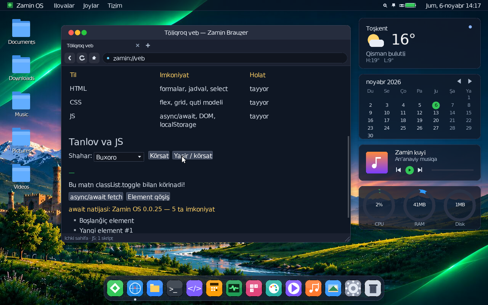 |
| **`<select>` ochiluvchi ro'yxat** | **Tablar (`Alt+T`, `+`, `×`)** |
| 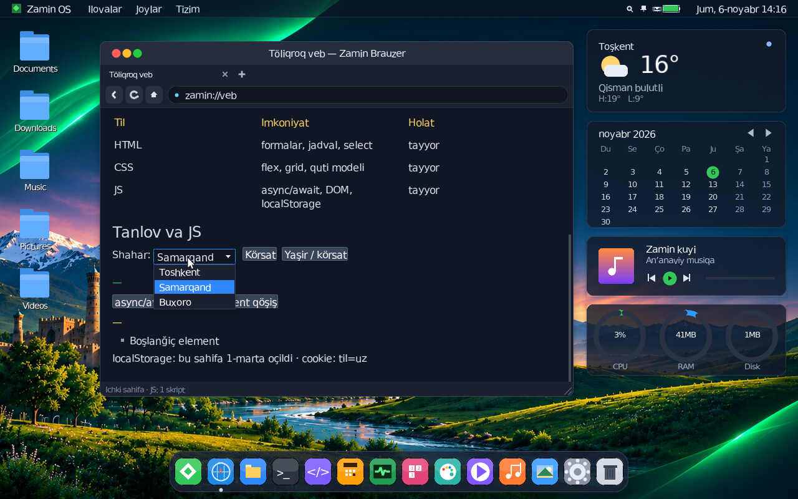 | 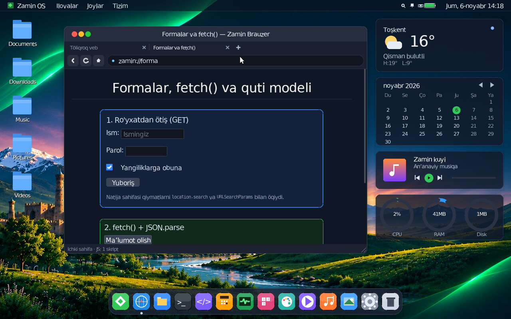 |

- **CSS joylashuvi** — `display:flex` (bolalar yonma-yon ustunlar, `gap`, `justify-content`,
  `flex: N`, ustun `width`), `display:grid` (`grid-template-columns: repeat(n, …)`),
  **jadvallar** (`<tr>` — qator, `<td>/<th>` — ustunlar); `>` (bevosita bola) tanlagichi.
  Joylashuv rekursiv: har ustun o'z kengligida qayta joylanadi.
- **position va float** — `position: relative` (`top/left/right/bottom` bilan siljitish,
  oqimdagi joyi saqlanadi), `position: absolute` (eng yaqin joylashgan ajdodga nisbatan;
  `width` bo'lmasa — mazmun kengligida, `right` bilan o'ngga bog'lanadi), `position: fixed`
  (sahifaga nisbatan), `float: left/right` (bloklar va ``: chetga suriladi, keyingi matn
  yonidan toraygan sohada oqadi; ketma-ket floatlar yonma-yon) va `clear: left/right/both`.
  Sinov sahifasi: `zamin://joylasuv`.
- **@media va :hover** — `@media` bloklari endi tashlanmaydi: `min-width`/`max-width`,
  `min-height`/`max-height`, `width`/`height`, diapazon sintaksisi (`(400px <= width < 700px)`),
  `screen`/`all`/`print`, `not`/`only`, `orientation`, `prefers-color-scheme` (yorug'),
  vergul (YOKI) va ichma-ich `@media` (VA); birliklar px/em/rem. So'rovlar brauzer oynasining
  sahifa eniga (CSS pikselda) qarab baholanadi — oyna o'lchami o'zgarib biror qoidaning holati
  almashsa, sahifa qayta tahlil qilinadi (skriptlar qayta bajariladi, aylantirish saqlanadi).
  `:hover` — sichqoncha ostidagi element va uning ajdodlari uchun (`a:hover`,
  `.karta:hover p`): rang, fon, qalinlik, o'lcham, `text-decoration` darhol qayta qo'llanadi.
- **`<canvas>` 2D** — `getContext('2d')` har canvas uchun o'z piksel buferini (ARGB, shaffof fon)
  beradi: `fillRect`, `strokeRect`, `clearRect`, yo'l — `beginPath`/`moveTo`/`lineTo`/`closePath`/
  `rect`/`arc` + `fill` (nonzero, silliqlangan) va `stroke` (`lineWidth`), `fillText`/`strokeText`
  (`font` px, `textAlign`, `textBaseline`), `measureText`; `fillStyle`/`strokeStyle` (nomli, `#hex`,
  `rgb/rgba` alfa bilan), `globalAlpha`; `canvas.width/height` o'zgarsa bufer qayta yaratiladi.
  Sinov: `zamin://html` (Canvas 2D bo'limi), yuklanish self-testida piksellar tekshiriladi.

  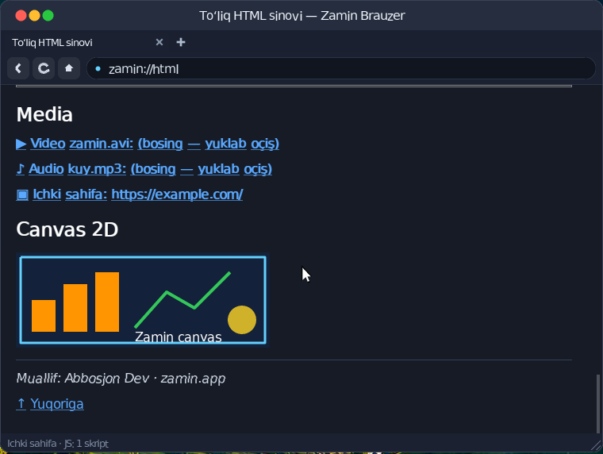
- **text-align va dir=rtl** — `text-align`: `left`/`right`/`center`/`justify` hamda yo'nalishga
  bog'liq `start`/`end` (meros bilan; `-webkit-center` ham). `justify` — so'zlar orasidagi bo'shliq
  kengaytiriladi, oxirgi qator start tomonda qoladi. Qator oxiridagi bo'shliq hisobga olinmaydi —
  o'ngga tekislangan matn chetga aniq taqaladi. `dir="rtl"`/`dir="ltr"` atributi va CSS `direction`:
  blok matni o'ngdan boshlanadi, ro'yxat va iqtibos chekinishi o'ng tomonga o'tadi (belgi `•`/`1.`
  va iqtibos chizig'i o'ngda), `<pre>` qatorlari ham tekislanadi, flex/grid/jadval ustunlari
  o'ngdan chapga joylashadi. JS: `el.style.textAlign`/`direction`. Sinov: `zamin://matn`.

  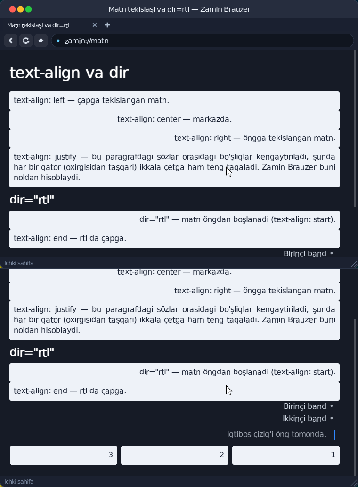
- **Yumaloq burchaklar (`border-radius`) — silliq va tishchasiz** — burchak qamrovi endi har
  piksel ichida teng taqsimlangan 4×4 namuna bilan hisoblanadi (avval namunalar piksel markazidan
  siljigan edi va yoy bo'ylab qirrali "tishchalar" chiqardi); yoy kesib o'tgan har piksel kamida
  kichik qamrov oladi (teshik qolmaydi). Yuqoridan qisman aylantirilgan quti endi faqat yuqori
  burchaklarini to'g'ri burchakka aylantiradi — pastki burchaklari yumaloq qoladi, yuqori chegara
  chizig'i esa ko'rinmaydi. Yuklanishdagi `self_test_round` qamrovni (r=1..30: ichkarida 255,
  tashqarida 0, monoton) va ofscreen buferda hech bir piksel fon/quti rangidan to'qroq emasligini
  tekshiradi.

  Veb quti endi **bitta o'tishda** chiziladi (`gfx::round_box`): fon (rang yoki
  `linear-gradient`) va `border` har piksel uchun tashqi va ichki (radius − qalinlik, markazi
  bir xil — CSS kabi) qamrov bo'yicha aralashtiriladi. Shu sababli chegara ostidan fonning AA
  cheti chiqmaydi, chegara halqalari orasida "chok" qolmaydi, gradientli quti ham chegarali
  bo'la oladi. Aylantirilgan quti endi to'liq geometriya bilan (yuqoridan ko'rinmaydigan qatorlar
  `skip` bilan) chiziladi: qisman ko'rinadigan yoy va radius aylantirishda o'zgarmaydi.
  `self_test_round` kengaytirildi: r=1..30 va chegara 1..4 px da `round_ring`, bir rangli va
  gradientli qutilar yorug' va to'q fonda — hech bir piksel fon/quti/chegara ranglarining eng
  to'qidan to'qroq emas; chegara rangi fon bilan bir xil bo'lsa natija oddiy quti bilan aynan
  bir xil; aylantirilgan quti to'liq qutining pastki qismi bilan aynan bir xil. `zamin://matn`
  ga `border: 2px solid`, `box-shadow`, gradient, gradient+chegara, ota fon ustidagi bola blok,
  flex va rtl ichidagi bloklar qo'shildi. Skrinshot tekshiruvchisi:
  `scripts/agent/check_corners.py surat.png` — har blok burchagi atrofidagi 6×6 hududda fondan
  va blok rangidan to'qroq piksel qidiradi. (Ichma-ich quti modeli endi bor — pastga qarang.)

  **Regressiya tekshiruvi:** `scripts/agent/verify.sh full` endi yuklanish sinovidan keyin
  `shot.py` bilan brauzerni ochib, to'rtta surat oladi — `zamin://matn` (boshi va yarim
  aylantirilgan holati), `zamin://bezak`, `zamin://overflow` — va har birini
  `check_corners.py` dan o'tkazadi (`[ok] burchaklar: 4 surat toza`). Tekshiruvchi bloklarni
  sahifa bo'yicha avtomatik taniydi: fon — sahifa chap chetidagi rang, qutilar — sahifada ko'p
  uchraydigan aniq ranglar (opacity bilan aralashganlari ham) va to'yingan piksellar
  (gradientli qutilar); `-v` bilan bloklar va burchaklar ro'yxatini chiqaradi. Tekshiruvchining
  o'zi ham sinanadi: burchak yaqiniga bitta qora piksel chizilgan surat 1 qaytarishi shart.
  Tuzatildi: `opacity < 1` li yumaloq quti aylantirilganda pastki burchaklari to'g'ri burchakka
  aylanib qolardi — endi `gfx::round_box_a` (alfa bilan, to'liq geometriya + `skip`) ishlatiladi.
  `self_test_round` ga alfa 128 bilan chizilgan qutilar qo'shildi (bir rangli va chegarali,
  yorug'/to'q fon, aylantirilgan holat).

  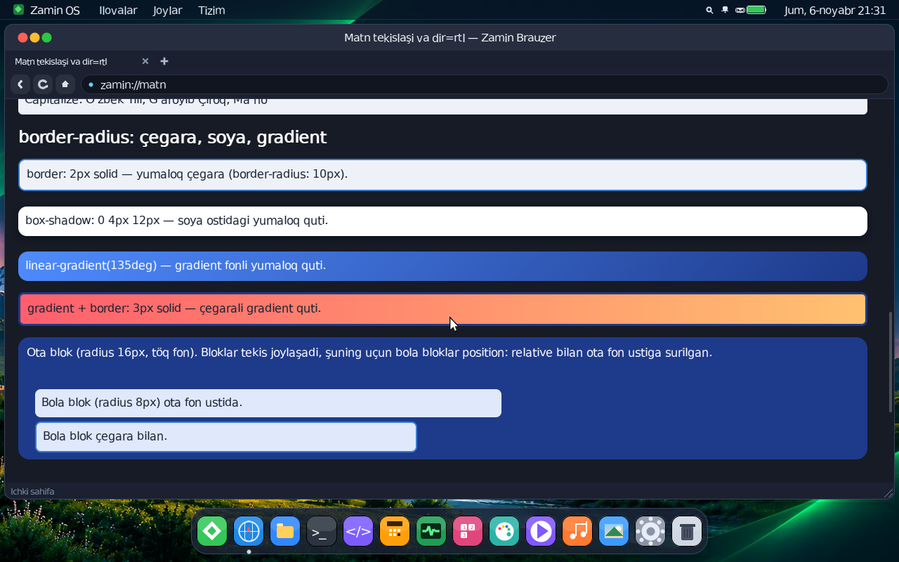

  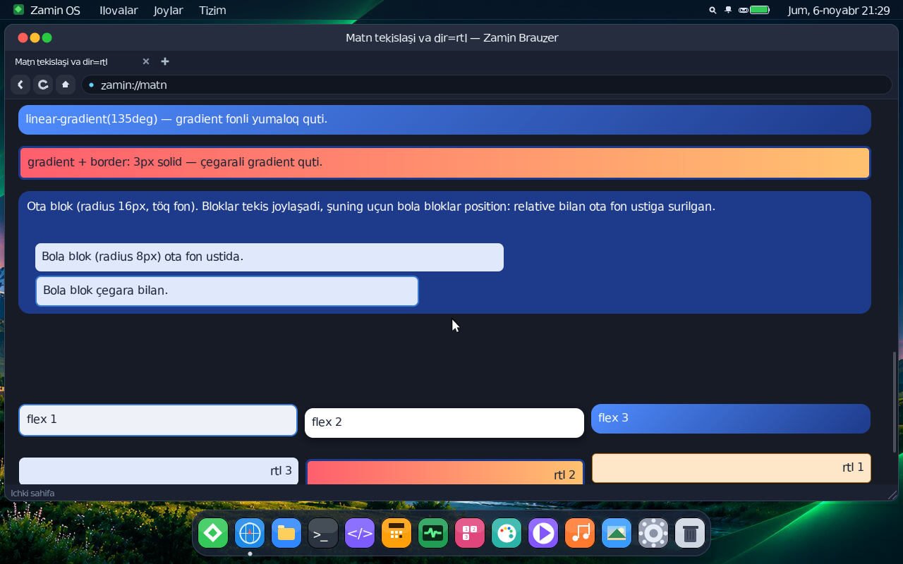
- **Ichma-ich blok konteynerlari** — ota blokning foni, chegarasi, padding'i va soyasi endi bola
  bloklarni haqiqatan o'rab oladi (karta ichida karta, sidebar ichidagi bloklar). `html::Block`
  eng yaqin quti (`bgk`) dan tashqari ajdod qutilar zanjirini saqlaydi (`outer: Vec<Cbox>` —
  seriya, fon, gradient, chegara, radius, padding, kenglik, chekinishlar, soya, opacity,
  `position: relative` siljishi); `Block::chain()` to'liq zanjirni beradi. `lay()` ochiq
  qutilar stekini yuritadi: har yangi quti ota qutining kontent sohasida (chap/o'ng chekinishlar
  yig'iladi) ochiladi, ota bezagi bolalarnikidan oldin chiziladi va barcha bolalar balandligini
  qamraydi; keyingi blok zanjirida yo'q qutilar ichkaridan tashqariga yopiladi (pastki
  padding + chegara + margin). Qo'shni bloklar `bgk` bo'yicha bitta qutiga birlashishi saqlandi.
  `zamin://matn` dagi `position: relative` aylanma yo'li olib tashlandi — endi oddiy
  `<div class=ota><div class=bola>…</div></div>` va 3 darajali misol. Sinov:
  `self_test_nested` (ota `padding:16px; border:2px` ichidagi bola x = ota x + 18, ota balandligi
  oxirgi bola pasti + padding dan kam emas, 3 darajada har bezak o'z otasi ichida).

  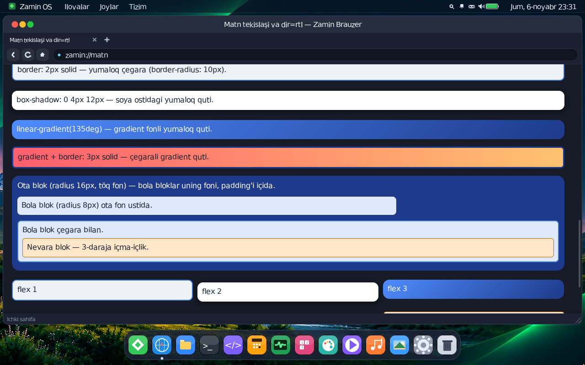
- **CSS `linear-gradient` va `box-shadow`** — `background` / `background-image` da
  `linear-gradient(<yo'nalish>, rang1 [joy%], rang2, …)`: yo'nalish — `to bottom|top|left|right`
  (va burchaklar, masalan `to top right`), `<N>deg`, `turn`, `rad` (standart — pastga); 2–6 rang
  to'xtashi (`#hex`, nomli, `rgb()`), joyi berilmaganlar teng taqsimlanadi. Ixtiyoriy burchakli
  gradient piksel bo'yicha hisoblanadi va `border-radius` silliq burchaklari bilan chiziladi
  (aylantirilganda rang chizig'i butun quti bo'yicha qoladi). `box-shadow: dx dy [blur [spread]]
  rang` (`rgba` alfa bilan) — yumaloq to'g'riburchak masofa funksiyasi orqali yumshoq soya,
  quti ostiga emas, atrofiga chiziladi; `none` — o'chiradi, `inset` hozircha e'tiborsiz. Yaroqsiz
  qiymatlar (yopilmagan `linear-gradient(`, noma'lum yo'nalish, rangsiz soya) panic qilmasdan
  tashlab yuboriladi va oldingi fon saqlanadi. JS: `el.style.background`/`boxShadow`. Sinov:
  `zamin://bezak`, yuklanish self-testida `self_test_decor` (35 tekshiruv).

  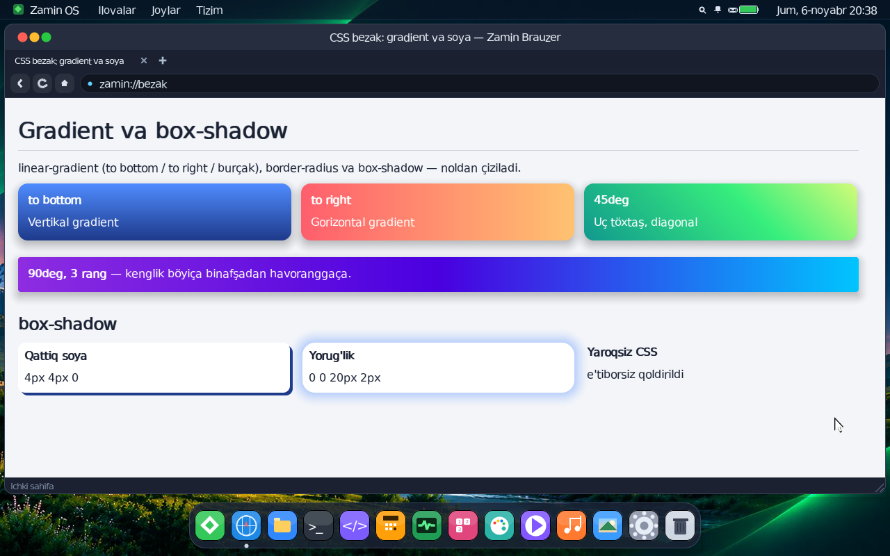
- **CSS `height` / `min-height`, `line-height` va `text-transform`** — `height` va `min-height`
  (px, em, rem, pt; `%` va `vh` — ko'rish maydoni balandligidan) blok darajasidagi elementlarga
  qo'llanadi va bolalarga meros bo'lib o'tmaydi: quti (fon, chegara) kamida shu balandlikda
  chiziladi, kontentsiz `div` ham joy egallaydi (keyingi blok pastga suriladi). `height` kontentdan
  kichik bo'lsa kontent tashib chiqadi, lekin keyingi blok belgilangan balandlikdan keyin
  boshlanadi. `line-height` — raqam (ko'paytuvchi, bolalarga shunday o'tadi), `px`/`em`/`%`
  (hisoblangan qiymat) yoki `normal`; matn qator ichida markazlanadi. `text-transform:
  uppercase|lowercase|capitalize|none` — meros bo'lib o'tadi, Unicode bo'yicha: yangi lotin
  alifbosi (ö/Ö, ğ/Ğ, ş/Ş, ç/Ç) va kirill (ш/Ш, ў/Ў, қ/Қ, ғ/Ғ, ҳ/Ҳ); `capitalize` so'z ichidagi
  tutuq va apostrofni (oʻ, gʻ, ʼ, ') yangi so'z deb hisoblamaydi, teglar chegarasida ham to'g'ri
  ishlaydi. Sinov: `zamin://matn` (yangi bo'lim), yuklanish self-testida `self_test_box_height`
  (23 tekshiruv: tahlil, meros, harf o'zgarishi va haqiqiy joylashuv o'lchovlari).

  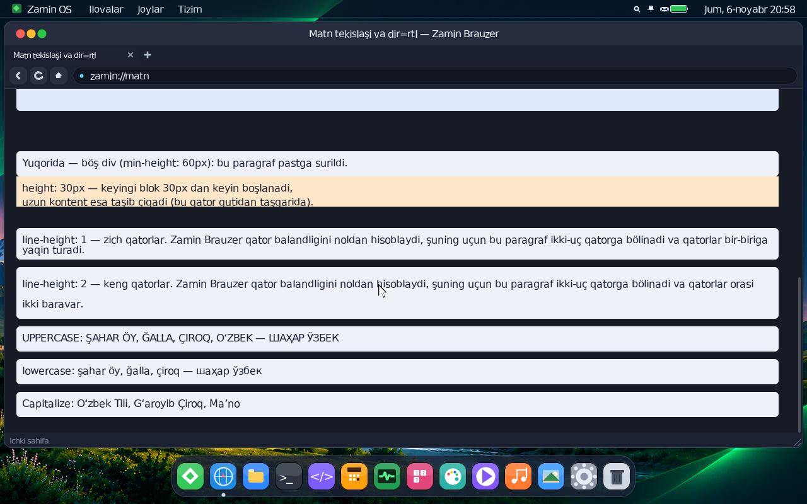
- **CSS `overflow`, `white-space`, `text-overflow: ellipsis` va `opacity`** — `overflow: hidden`
  (`auto` / `scroll` / `clip` hozircha shunday ishlaydi, `overflow-x/-y` ham) blok bolalarini
  konteyner to'rtburchagi bilan kesadi: fon/chegarasi bo'lsa — chegara ichidagi soha, aks holda
  `height` bilan cheklangan soha; butunlay tashqaridagi elementlar tashlanadi, qisman
  ko'rinadiganlari chizishda `set_clip` bilan qirqiladi. `white-space: nowrap` — qator o'ralmaydi;
  `pre` / `pre-wrap` — bo'shliqlar va `\n` saqlanadi (`pre-wrap` o'raladi); `pre-line` — bo'shliqlar
  yig'iladi, `\n` saqlanadi (meros bo'lib o'tadi). `text-overflow: ellipsis` sig'magan qatorni `…`
  bilan tugatadi, qator eni konteynerdan oshmaydi. `opacity` (0..1 yoki %) — ajdodlar bo'yicha
  ko'paytiriladi: quti foni yarim shaffof (`fill_round_rect_a`), gradient/chegara va matn ranglari
  orqa fon bilan aralashtiriladi. Sinov: `zamin://overflow`, yuklanish self-testida
  `self_test_overflow` (25 tekshiruv: tahlil, meros, qirqish, nowrap, ellipsis, pre va opacity).

  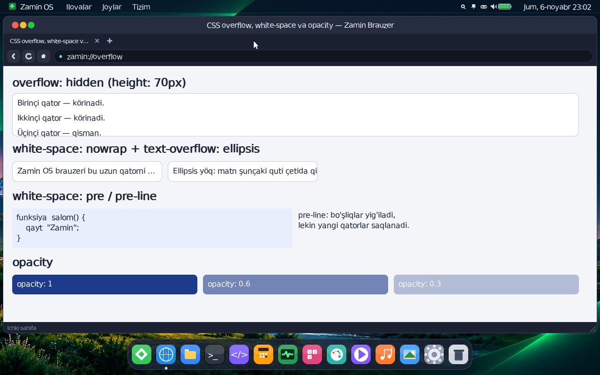
- **`<iframe>` — ichki hujjat haqiqiy chiziladi** — `srcdoc="…"` (belgilar bilan kodlangan yoki
  tirnoq ichida xom HTML) alohida hujjat sifatida **o'z CSS i bilan** tahlil qilinadi va ramka-quti
  ichida chiziladi: fon — ichki `body` foni (bo'lmasa oq), `width` (px yoki %) yoki CSS `width`,
  `frameborder="0"`. Ichki `<style>` ota sahifaga oqib chiqmaydi; ichki elementlar ota JS dan
  ajratilgan (id/klass/onclick ko'rinmaydi), ichki rasmlar va SVG yuklanadi. **Bir xil manbali
  `src`** (o'sha sxema+xost, ichki `zamin://` sahifalar yoki mahalliy fayllar) fonda yuklanadi va
  `srcdoc` ga aylantiriladi (4 tagacha, 2 daraja ichma-ich; `@media` qayta tahlilida saqlanadi).
  Boshqa manbali `src` — avvalgidek havola-kartochka. Cheklovlar: ichki skriptlar bajarilmaydi,
  `height` hisobga olinmaydi (ramka mazmun bo'yicha cho'ziladi), ichki havolalar asosiy sahifani
  ochadi. Sinov: `zamin://ramka`, yuklanish self-testida 8 tekshiruv.

  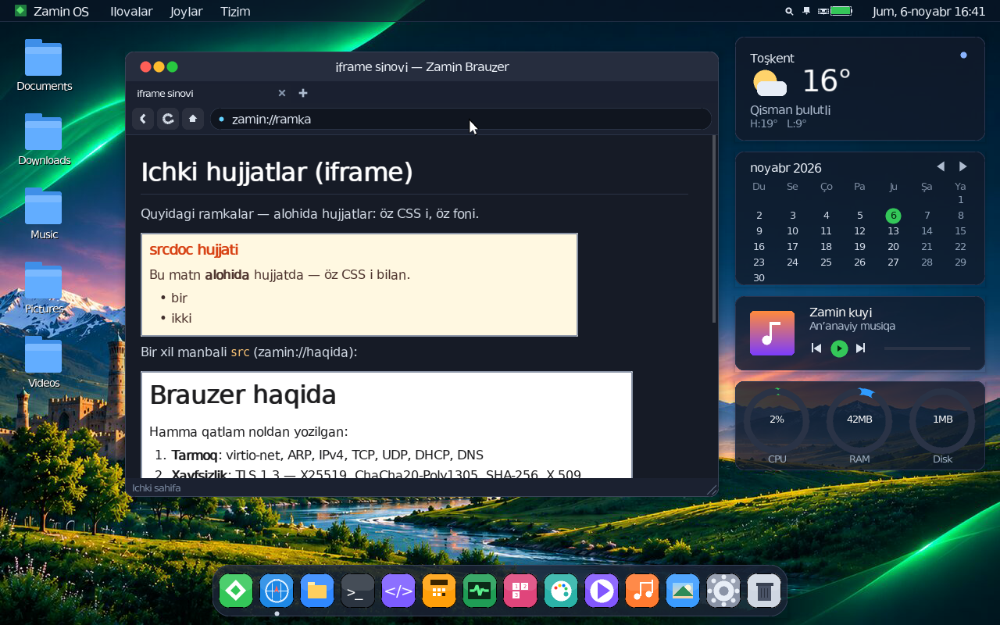
- **`<audio>` / `<video>`** — `<audio>` endi ijro tugmasini beradi: `▶ Ijro / ■ to'xtatish` bosilsa
  fayl (`src` yoki `<source>`; bir nechta manba bo'lsa **WAV** afzal ko'riladi) yuklanadi, o'z
  dekoderlarimiz bilan (WAV · AIFF · FLAC · MP3 · OGG) PCM ga aylantiriladi va **virtio-sound**
  orqali fonda chalinadi; qayta bosilsa — to'xtaydi. Bildirishnomada nom, chastota va davomiylik.
  Qurilma bo'lmasa (`-device virtio-sound-device` yo'q) — ogohlantirish. `data:` URI ham ishlaydi;
  `↓ yuklab olish` havolasi saqlanadi. `<video poster="…">` — **poster rasmi** (`width/height`
  bilan, rasm kabi yuklanadi; `data:` SVG ham) chiziladi, bosilsa video fayl ochiladi/yuklanadi.
  Zaxira matn yashirin. Sinov: `zamin://html` (Media bo'limi, namuna `zamin://namuna.wav`),
  yuklanish self-testida 6 tekshiruv.

  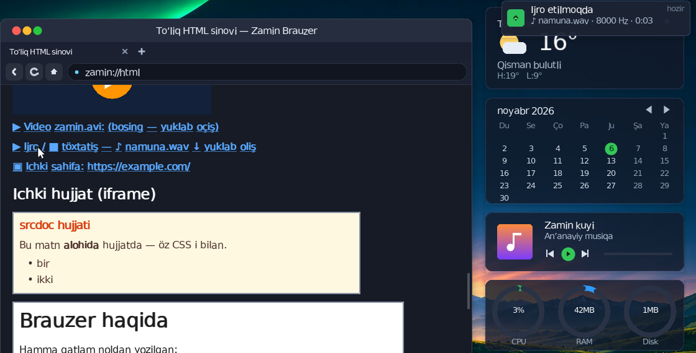
- **JS** — `async function`, `async () =>`, `await` (fetch va taymerlarni kutadi),
  `localStorage`/`sessionStorage`, `document.cookie`.
- **DOM** — har bir element ro'yxatda (ota-bolasi bilan): `innerHTML = "<b>…</b>"` (HTML
  tahlil qilinadi), `createElement` + `appendChild`/`append`, `insertAdjacentHTML`,
  `querySelector(All)` (`#id`, `.klass`, `teg`, `teg.klass`), `getElementsByClassName/TagName`,
  `classList.add/remove/toggle/contains` (uslub qayta qo'llanadi), `className`, `hidden`,
  `parentElement`, `children`, `remove()`, `setAttribute`; bosish hodisasi **qalqib chiqadi**
  (ota elementlar ishlovchilari ham ishlaydi). `display:none` elementlar ham quriladi —
  JS keyin ko'rsata oladi.
- **HTTP cookie** — `Set-Cookie` saqlanadi, keyingi so'rovlarda `Cookie:` yuboriladi.
- **Doimiy xotira** — `localStorage` va cookie lar foydalanuvchining `~/.zamin/localstorage`
  hamda `~/.zamin/cookies` fayllariga (shifrlangan ZaminFS orqali) yoziladi: qayta
  yuklangandan keyin ham saqlanib qoladi. Har foydalanuvchining o'z ombori bor; tizimga
  kirilmagan bo'lsa — faqat xotirada. Format — TAB bilan ajratilgan satrlar (`\t`, `\n`, `\\`
  qochiriladi). O'zgarish bo'lmasa diskka qayta yozilmaydi.
- **`<select>/<option>`** — ochiluvchi ro'yxat, forma bilan yuboriladi, JS `.value`.
- **Tablar** — `Alt+T` yoki `+` — yangi tab, `×` yoki `Alt+W` — yopish; har tab o'z sahifasi,
  tarixi va JS holati bilan; nofaol tablar ham fonda yuklanadi.

### Brauzer: formalar, fetch() va quti modeli

| Forma (quti modeli: border, radius, max-width, margin:auto) | Natija: `location.search` + `URLSearchParams` |
|---|---|
| 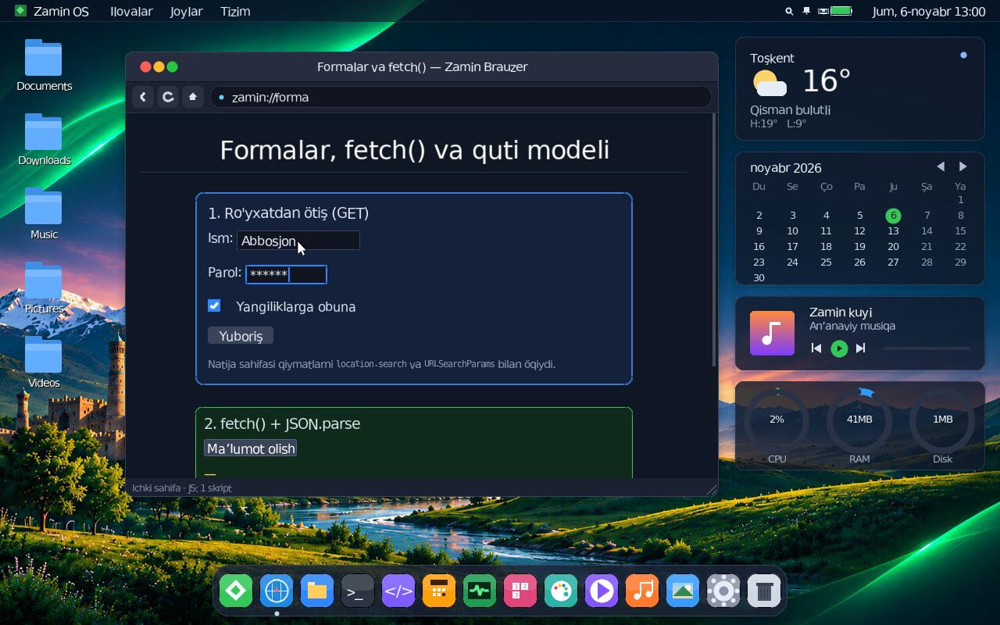 | 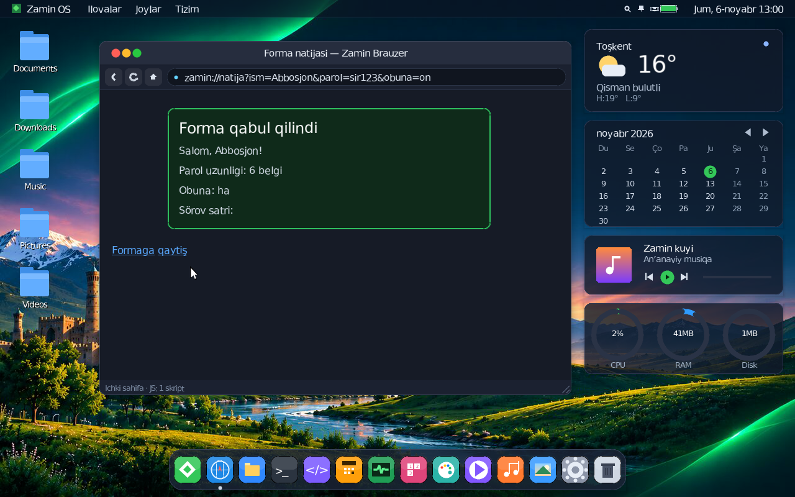 |
| **HTTP: `fetch` GET/POST (JSON) va POST forma** | **Tarix: `zamin://tarix`** |
| 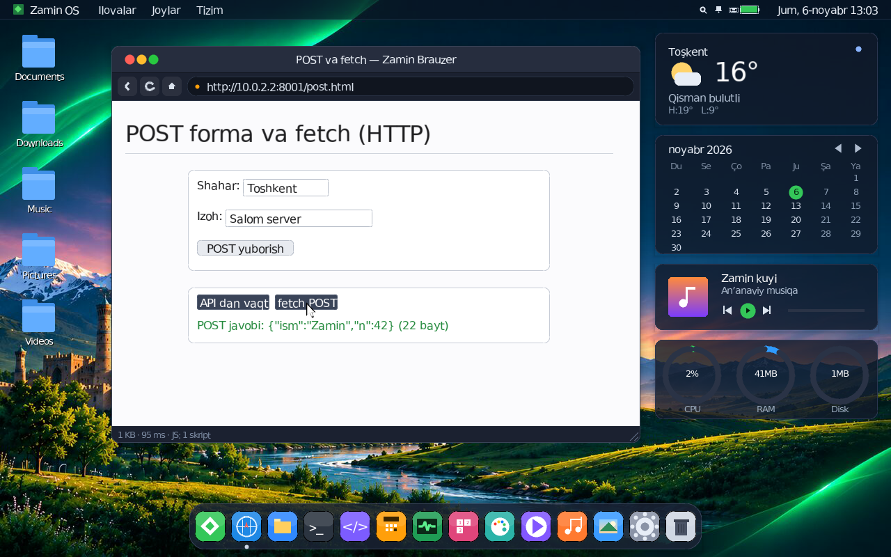 | 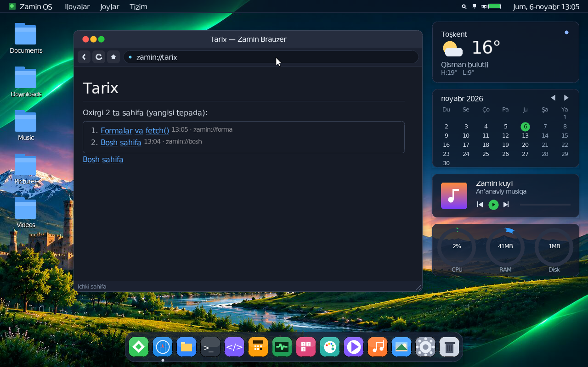 |

- **Formalar** — `<form action method=get|post>`, `<input>` (text, password, checkbox,
  submit, hidden), `<textarea>`, `<button>`. Maydonni bosib yozish, `Tab` — keyingisi,
  `Enter` — yuborish, `Esc` — fokusdan chiqish. GET — so'rov satri, POST — tana
  (`application/x-www-form-urlencoded`); JS: `input.value/checked`, `submit` hodisasi
  va `preventDefault()`.
- **`fetch()` + Promise** — `.then/.catch/.finally`, `new Promise`, `Promise.resolve/reject/all`,
  javob: `status`, `ok`, `text()`, `json()`; `fetch(url, {method: "POST", body})`.
  So'rovlar fon vazifasida bajariladi, natija mikrovazifalar navbati orqali.
  Qo'shimcha: `JSON.parse`, `encodeURIComponent/decodeURIComponent`, `URLSearchParams`,
  `location.href/search/host/pathname`.
- **HTTP** — `net::http::send` (istalgan usul + tana), 303 dan keyin GET.
- **CSS quti modeli** — `margin` (shu jumladan `auto` — markazlash), `padding`, `border`,
  `border-radius`, `width`/`max-width` (px, %); qo'shni bloklar bitta quti bo'lib chiziladi.
- **Tarix** — `zamin://tarix` (oxirgi 50 sahifa, vaqti bilan).

### Brauzer: CSS, JavaScript, rasmlar va fonda yuklash

| Bosh sahifa: CSS + JS (jonli soat, tugma) | JS va CSS sinovi + F12 konsoli |
|---|---|
| 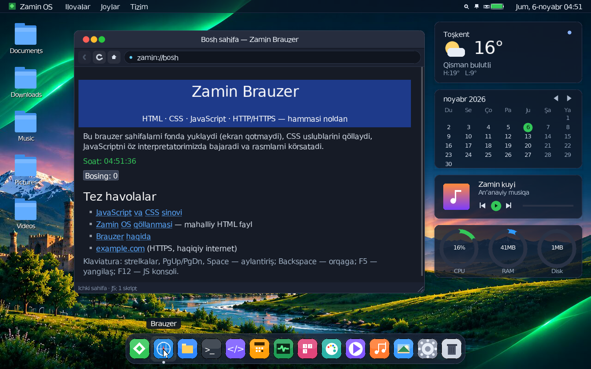 | 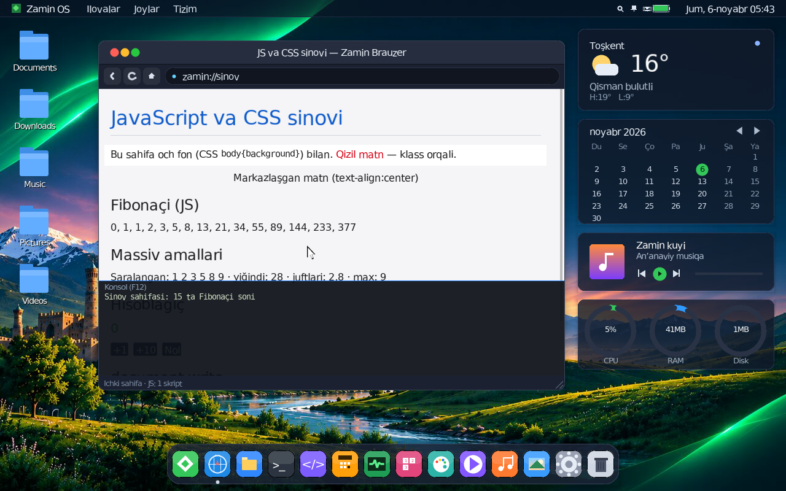 |
| **Tashqi CSS, JS va PNG rasm (HTTP)** | **Fayl yuklab olish → ~/Yuklamalar** |
| 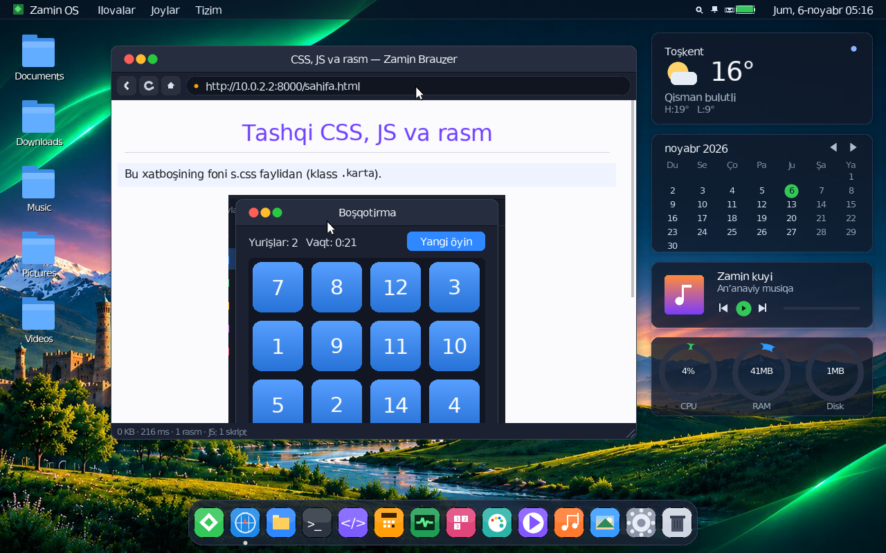 | 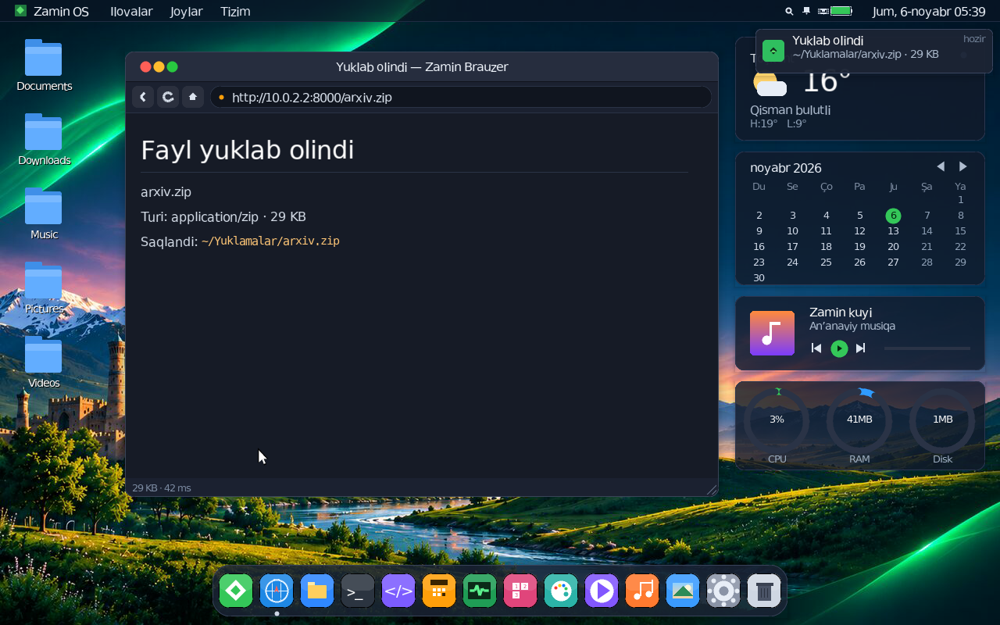 |

- **JavaScript (`js` moduli, noldan)** — leksik tahlil → AST → bajarish. `let/const/var`,
  funksiyalar (deklaratsiya, ifoda, strelkali), yopilmalar, `if/for/while/do`, `for…of/in`,
  `try/catch/throw`, `?:`, `&&`/`||`/`??`, `...` (spread), shablon satrlar `${…}`, massiv
  usullari (`map/filter/reduce/sort/…`), satr usullari, `Math`, `Date`, `JSON.stringify`,
  `Object.keys`. **DOM**: `document.getElementById/querySelector/write/title`,
  `element.textContent/innerHTML/style.*`, `onclick` va `addEventListener('click')`,
  `setTimeout/setInterval`, `console.log` (F12 — konsol), `alert` — bildirishnoma.
  Cheksiz sikl va chuqur rekursiyadan himoya (qadamlar soni va stek o'lchovi).
- **CSS (`css` moduli)** — `<style>`, `style=""` va tashqi `<link rel=stylesheet>`:
  teg/`.klass`/`#id`/avlod/`:hover` tanlagichlari, `@media`, `color`, `background`, `font-size` (px/em/rem/%/pt),
  `font-weight`, `text-align` (start/end/justify), `direction`, `display:none`, `visibility`, `text-decoration`; meros
  (inheritance) va brauzerning o'z uslublari; `<body>`/`<html>` yashirin bo'lsa ham qo'llanadi.
- **Rasmlar** — `` HTTP yoki fayldan yuklanib, o'z dekoderlarimiz bilan ochiladi
  (PNG, JPEG, GIF, BMP, SVG…), aylantirishda to'g'ri qirqiladi; to'g'ridan-to'g'ri rasm manzili ham.
- **Fonda yuklash** — sahifa, CSS, skriptlar va rasmlar alohida yadro vazifasida (`brauzer`)
  yuklanadi: ekran qotmaydi, yuklash chizig'i va to'xtatish tugmasi bor.
- **Yuklab olish** — HTML/matn/rasm bo'lmagan fayllar `~/Yuklamalar` ga saqlanadi.

Tuzatilgan tizim xatolari (shu bosqichda topildi):
- **TCP ABBA tiqilishi**: `tcp::handle/tick` CONNS qulfini ushlab `wake_event` (SCHED)
  chaqirardi, `wait_event` esa SCHED → CONNS tartibida — ikki yadro bir-birini kutib,
  butun rejalashtiruvchi to'xtardi. Endi uyg'otish qulf bo'shatilgandan keyin.
- **ARP kutishi qulf ichida**: `tcp::connect` SYN ni CONNS qulfi ichida yuborar, ARP
  javobini esa uxlab kutardi. Endi ARP qulfdan tashqarida hal qilinadi.
- **`tcp::recv` vaqt chekloviga e'tibor bermasdi** (paket kelmasa hech kim uyg'otmasdi).
- **Yadro steki 32 → 60 KiB** (64 KiB oynada; pastki 4 KiB — qo'rg'on sahifa, `vectors.s`
  tekshiruvi yangilandi) — daraxt bo'ylab ishlovchi interpretatorlar uchun.

### Brauzer: HTTP, HTTPS va HTML — noldan

| HTTP (mahalliy server) | HTTPS — haqiqiy internet (example.com, TLS 1.3) |
|---|---|
| 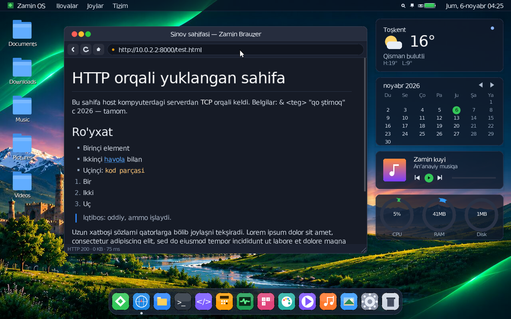 | 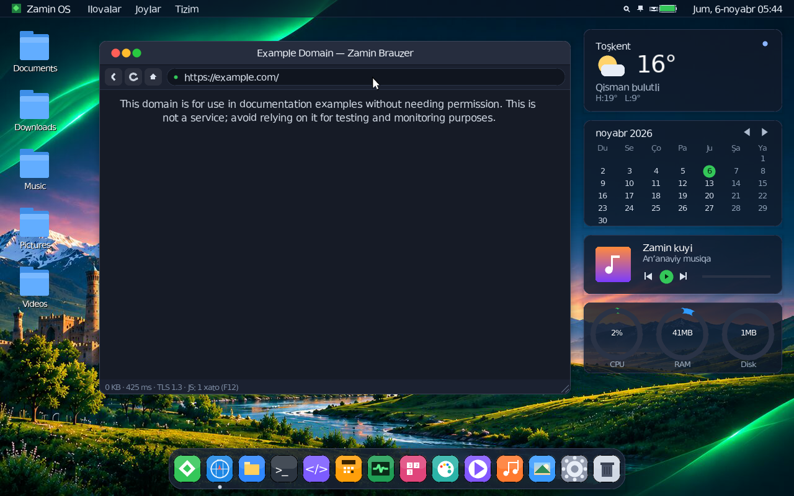 |

- **`net::http`** — HTTP/1.1 GET mijozi: `http://` (TCP) va `https://` (öz TLS 1.3 stekimiz:
  X25519 + ChaCha20-Poly1305 + X.509), yönaltirişlar, `chunked`, Content-Length bilan
  erta tugatiş, vaqt çeklovlari, nisbiy havolalarni yeçiş.
- **`html`** — HTML tahlilçisi: sarlavhalar, xatboşilar, tartibli/tartibsiz ro'yxatlar,
  havolalar, qalin, `kod`, `<pre>`, iqtiboslar, `<hr>`, belgilar (`&amp;` `&#NN;`),
  `<script>`/`<style>` taşlanadi.
- Manzil qatori, orqaga / yangilaş / bosh sahifa, havolani bosib ötiş, aylantiriş
  (gʻildirak, strelkalar, PgUp/PgDn, Space), holat qatori (HTTP kodi, hajm, vaqt).
- Ichki sahifalar `zamin://bosh`, `zamin://haqida`; mahalliy `.html` fayllar Fayllardan
  brauzerda oçiladi (namuna: `~/Hujjatlar/zamin.html`).

### Chizma, Soat (sekundomer, taymer) va dok menyusi

| Chizma + Taymer | Sekundomer |
|---|---|
|  | 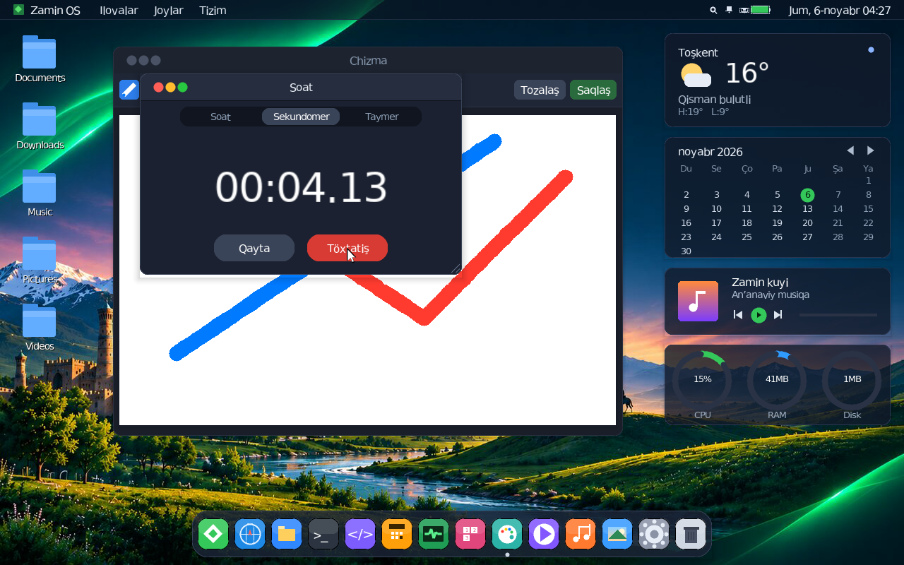 |

- **Chizma** — qalam va öçirgiç, 3 ölçam, 10 rang, tuval 720×450; **Saqlaş** —
  PNG (öz kodlovçimiz) `~/Rasmlar/chizma-HHMMSS.png` ga.
- **Soat** — 3 bölim: analog soat, **sekundomer** (yuzdan bir soniya aniqligida, töxtatiş/
  qayta), **taymer** (30 s … 10 daq, halqa körsatkiç, tugaganda bildirişnoma).
- **Dok kontekst menyusi** (öng tugma): Körsatiş, Yangi oyna / Oçiş, Yopiş (N),
  savat uçun — Savatni böşatiş.

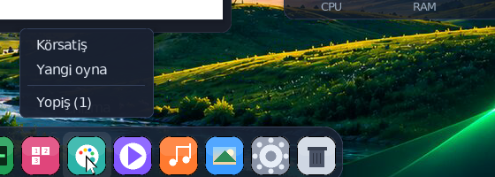

### Oyna yopiştiriş, sudrab tashlaş va ekran rasmi

| Yopiştiriş (çap/öng yarim) + matn muharriri | Faylni sudrab tashlaş |
|---|---|
| 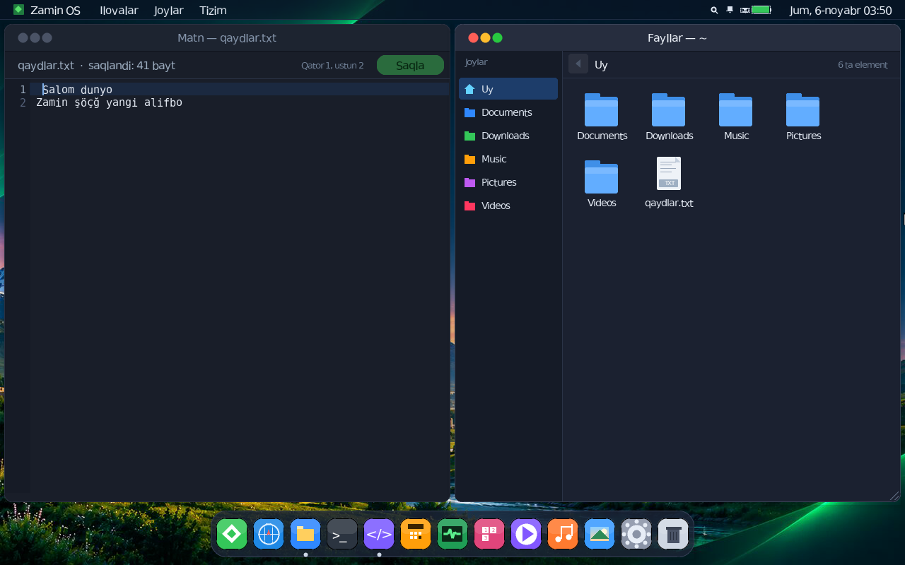 | 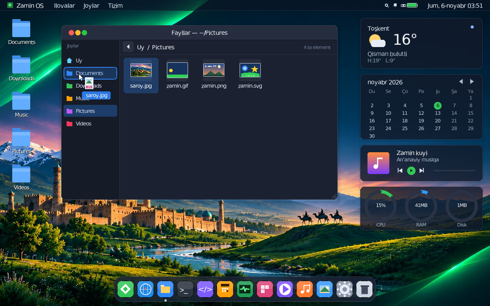 |

- **Yopiştiriş (snap)**: oynani ekranning çap/öng çetiga sudrang — yarim ekranga,
  tepaga — toʻliq ekranga yopişadi (oldindan körinişi yoritiladi). Sarlavhani **ikki marta
  bosiş** — kattalaştiriş/qaytariş; yopiştirilgan oynani sudrasangiz — avvalgi ölçamiga qaytadi.
- **Sudrab tashlaş**: Fayllardagi elementni papkaga, yon paneldagi joyga, boşqa Fayllar
  oynasiga, ish stoli papkasiga yoki dokdagi **Savatga** sudrang (Shift — nusxalaydi).
- **Ekran rasmi**: `PrtSc` yoki Tizim → Ekran rasmi — `~/Rasmlar/ekran-YYYYMMDD-HHMMSS.png`.
  PNG **kodlovçisi noldan** yozildi: qator filtrlari (None/Sub/Up, eng yaxşisi tanlanadi),
  deflate (qatʼiy Huffman + LZ77 xesh zanjiri), CRC32, Adler-32; öz dekoderimiz bilan
  self-test orqali tekşiriladi.
- **Matn muharriri**: haqiqiy kursor (strelkalar, Home/End, PgUp/PgDn, Delete, Tab),
  siçqon bilan joylaş, aylantiriş, "Qator, ustun" körsatkiçi, saqlanmagan özgariş belgisi `*`,
  `Alt+S` — saqlaş.
  - **Bekor qiliş / qaytariş**: `Alt+Z` / `Alt+Shift+Z`, 200 qadamgaça, kursor örni bilan
    tiklanadi. Ketma-ket yozilgan söz — bitta qadam; Enter, öçiriş, joylaş — alohida qadam;
    yangi tahrir qaytariş stekini tozalaydi.
  - **Qidiruv**: `Alt+K` (`Alt+F` — oynani kattalaştiriş bilan band) — pastda "Qidir:" maydoni,
    mosliklar sariq fon bilan belgilanadi, `Enter` — keyingisi (oxiridan boşiga aylanadi),
    `Esc` — yopiş; holat qatorida `k/n moslik`. UTF-8 (ş, ö, ʼ) ustunlari belgilarda hisoblanadi.
    Mantiq sof `src/edit.rs` modulida (`EditHistory`, `find_all`) va self-testda tekşiriladi.

  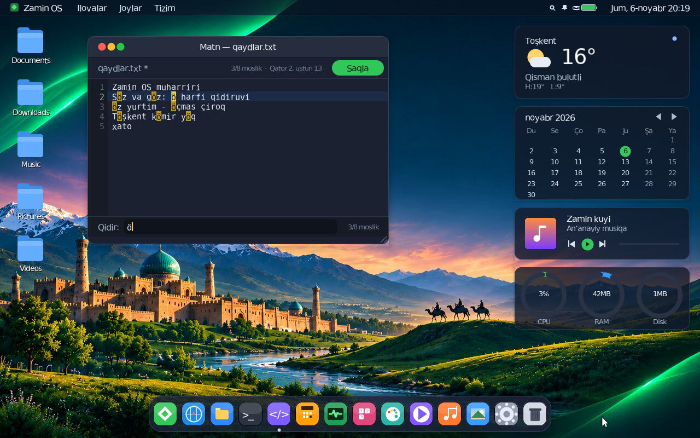
  - **Matn tanlaş va tizim almaşuv buferi**: `Shift` + strelkalar / `Home` / `End` / `PgUp` /
    `PgDn` tanlaşni kengaytiradi va toraytiradi (kursor langarga qaytsa — tanlaş bekor),
    `Shift` siz harakat tanlaşni bekor qiladi; siçqon bilan sudrab tanlaş (çekkadan taşqariga
    sudralsa matn aylanadi); `Alt+A` — hammasini tanlaş. Tanlangan hudud asosiy rang (accent)
    foni bilan körsatiladi, holat qatorida `tanlangan: N belgi`. `Alt+C` — nusxa, `Alt+X` —
    kesiş, `Alt+V` — joylaş (köp qatorli ham); tanlangan matn ustiga yozilsa (yoki Enter,
    Backspace/Delete) u almaştiriladi. Kesiş, joylaş va tanlaşni almaştiriş tarixga **bitta**
    qadam bölib yoziladi (`Alt+Z` bilan bir marta qaytariladi). Bufer umumiy (`src/clip.rs`,
    spin-qulf bilan `set`/`get`): muharrirdan nusxa olingan matnni brauzer manzil qatoriga va
    `<input>` maydonlariga ham `Alt+V` bilan joylaş mumkin (yangi qatorlar boşliqqa aylanadi).
    Mantiq `src/edit.rs` da (`range_text`, `delete_range`, `insert_text`, `replace_sel`,
    `nav_select`); self-test köp qatorli tanlaş, nusxa, kesiş, joylaş, ustiga yoziş va Alt+Z ni
    ğ, ö, ç harflari bilan tekşiradi.

  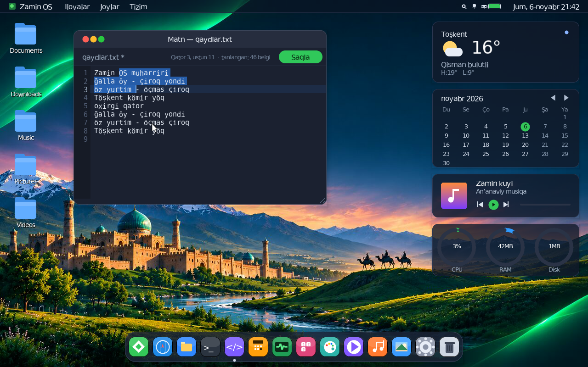
- **Oʻzbekça harflar**: `AltGr` (öng Alt) + `s` `c` `o` `g` `'` → **ş ç ö ğ ʼ**
  (Shift bilan — Ş Ç Ö Ğ) — barça ilovalarda va terminalda.

### Kalkulyator va Tizim monitori

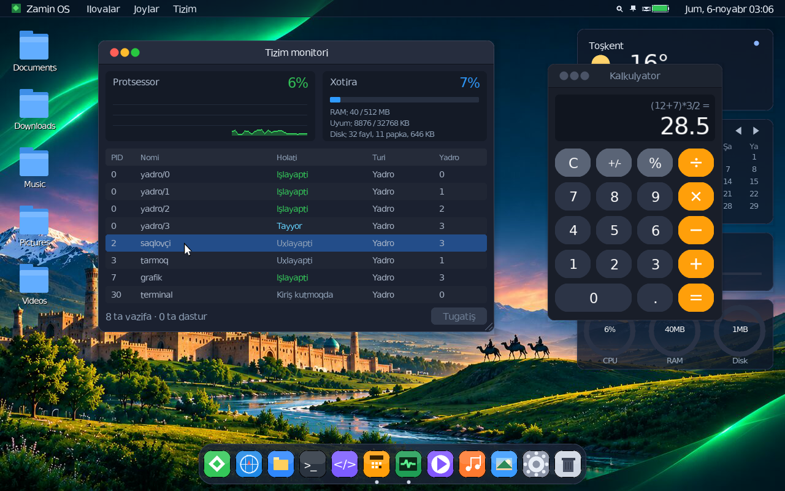

- **Kalkulyator** — siçqon yoki klaviatura (raqamlar, `+ - * / ( ) %`, `Enter`/`=`,
  `Backspace`, `C`); ifoda qavslar va ustuvorlik bilan hisoblanadi, oldingi ifoda
  displey tepasida körinadi.
- **Tizim monitori** — oxirgi 60 soniyalik CPU grafigi (rejalaştiruvçi namunalari),
  RAM/uyum/disk, barça vazifalar jadvali (PID, nomi, holati, turi, yadro raqami);
  dastur jarayonini tanlab **Tugatiş** (`task::kill`, ruxsat tekşiruvi bilan).

### Rasm va video köruvçi

| Rasm: oldingi / keyingi | Video: ijro / pauza va progress |
|---|---|
| 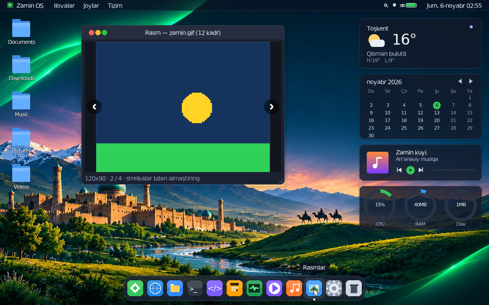 | 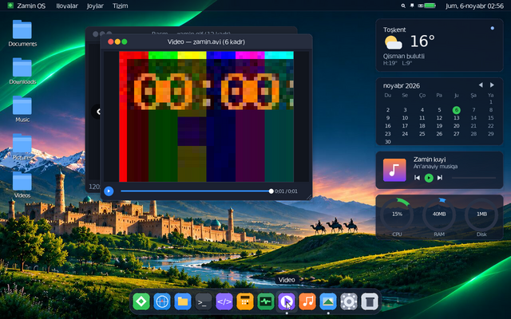 |

Papkada bir nechta rasm bölsa — çap/öng **strelkalar** (yoki `←`/`→`) bilan almaşadi,
pastda "2 / 4". Video oynasida **ijro/pauza** tugmasi (`Space`), kadrlar böyiça
**progress chizig'i** (bosib kerakli joyga ötiladi) va vaqt.

### Tezkor qidiruv (Alt+Space)

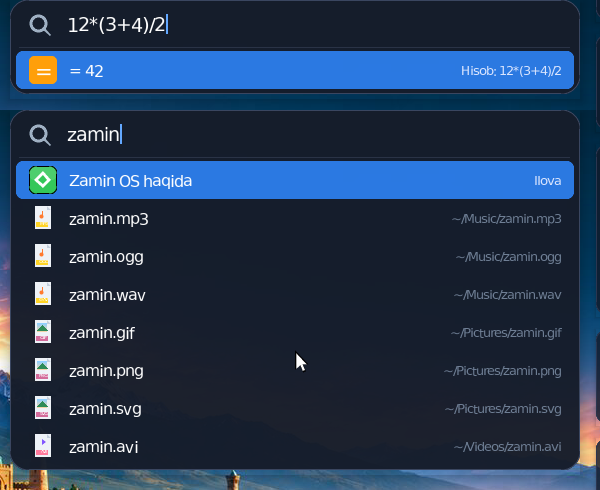

`Alt+Space` yoki menyu panelidagi lupa — bitta maydondan:
- **ilovalar** (nomi böyiça),
- **papka va fayllar** (uy papkasi içida, yöli bilan) — Enter mos ilovada oçadi,
- **kalkulyator**: `12*(3+4)/2` → `= 42` (+ − × ÷, qavslar, kasrlar),
- **tizim amallari**: qayta yuklaş, öçiriş.

↑/↓ — tanlaş, Enter — oçiş, Esc — yopiş, siçqon bilan ham bosiladi.

<br clear="right">

### Klaviatura yorliqlari va bildirişnomalar

| Ilova almaştirgiç (Alt+Tab) | Bildirişnomalar markazi |
|---|---|
|  |  |

| Yorliq | Amal |
|---|---|
| `Alt+Space` | Tezkor qidiruv (ilova, fayl, hisob) |
| `Alt+Tab` / `Alt+Shift+Tab` | Ilova almaştirgiç — Alt qoʻyib yuborilganda tanlangan oyna faollaşadi (yashirilgani ham) |
| `Alt+W` | Faol oynani yopiş |
| `Alt+M` | Faol oynani dokka yashiriş |
| `Alt+F` | Kattalaştiriş / oldingi ölçam |
| `Alt+C` / `Alt+X` / `Alt+V` | Fayllarda: nusxa olish / kesiş / joylaş; muharrirda — tanlangan matn (tizim almaşuv buferi); brauzer manzil qatori va `<input>` da — joylaş |
| `Shift` + strelkalar / `Home` / `End`, `Alt+A` | Matn muharririda tanlaş / hammasini tanlaş |
| `F2`, `Delete` | Fayllarda: nomini özgartiriş, savatga tashlaş |
| `Alt+S` | Matn muharririda saqlaş |
| `Alt+Z` / `Alt+Shift+Z` | Matn muharririda bekor qiliş / qaytariş |
| `Alt+K` | Matn muharririda qidiruv (`Enter` — keyingisi, `Esc` — yopiş) |
| `PrtSc` | Ekran rasmi (PNG, ~/Rasmlar) |
| `AltGr` + s/c/o/g/' | ş ç ö ğ ʼ |
| `Esc` | Menyu, bildirişnomalar paneli va almaştirgiçni yopiş |
| `Ctrl+C` | Grafik terminalda: oldingi plandagi dasturni töxtatiş (`^C`); dastur yöq bölsa — kiriş qatorini bekor qiliş va yangi taklif |
| `Ctrl+L` / `Ctrl+U` | Grafik terminalda: ekranni tozalaş (tarix yuqoriga aylantirib körinadi) / kiriş qatorini öçiriş |
| `Ctrl+D` | Grafik terminalda böş qatorda — terminal oynasini yopiş |

**Bildirişnomalar** öng yuqoridan sirpanib çiqadi (4.5 s, bosilsa yopiladi), menyu
panelidagi qoʻngʻiroq — oxirgi xabarlar tarixi ("Tozalaş" bilan). Yadroning istalgan
joyidan `gui::notify(sarlavha, matn, rang)` bilan yuboriladi. Hozir: kiriş, fayl
saqlaş, övoz qurilmasi yöqligi haqida.

### Qulf ekrani


Fon rasmi (xiralashtirilgan), katta soat va toʻliq sana, shishasimon kiriş kartasi.

### Ilovalar

| Fayllar | Terminal |
|---|---|
|  |  |
| Yon panel (Joylar), orqaga tugmasi va yöl, katta ikonali grid. Rasmlar uçun **haqiqiy eskizlar** (PNG/GIF/SVG — öz dekoderlarimiz bilan). | Haqiqiy EL0 jarayoni bilan quvur orqali bogʻlangan. Rangli prompt (`user@zamin` — yashil, yöl — koʻk), blok kursor. |

| Sozlamalar | Brauzer |
|---|---|
|  |  |
| Bölimlar ro'yxati va tizim maʼlumoti (versiya, foydalanuvçi, xotira, ekran). | Manzil qatori va boşlang'iç sahifa (tarmoq qatlami tayyorlanmoqda). |

| Musiqa pleeri | Boşqotirma |
|---|---|
|  |  |
| Muqova, nom, format maʼlumoti, normallaşgan toʻlqin (ijro qilingan qismi yashil), ijro tugmasi. MP3/OGG/FLAC/WAV/AIFF. | 15 ta raqamli plitka öyini: siçqon (qator/ustun böylab bir nechtasini suradi) yoki strelkalar; yurişlar va vaqt hisobi, har doim yeçiladigan aralaştiriş. |

Barça skrinshotlar QEMU da (virtio-gpu) QMP `screendump` orqali olingan — haqiqiy render.
Dizayn namunasi: [`docs/design-mockup.png`](docs/design-mockup.png).

## Işga tuşiriş

```bash
# Talablar: rustup, qemu-system-aarch64
rustup target add aarch64-unknown-none-softfloat   # rust-toolchain.toml buni avtomatik qiladi
cargo run                                # QEMU virt maşinasida işga tuşadi
```

`cargo run` disk obrazini (`target/zamin-disk.img`, 32 MiB) birinçi marta özi yaratadi —
unda tizim sozlamalari saqlanadi.

Işga tuşgaç **Zamin terminali** oçiladi (`zamin>`). `yordam` buyruqlar röyxatini
körsatadi, `öçir` (yoki `ochir`) tizimni öçiradi. Majburan çiqiş: `Ctrl+A`, keyin `X`.

## Birinçi işga tuşiriş

Tizim birinçi marta yoqilganda **birinçi sozlaş** boşlanadi:

1. **Til** — özbekça, русский yoki English. Tanlangan til butun tizimga qöllanadi:
   xabarlar, buyruqlar yordami va **tizim papkalari nomlari** ham.
2. **Töliq ism** — masalan, "Abbosjon Dev".
3. **Foydalanuvçi nomi (login)** — ismdan avtomatik taklif qilinadi ("Аббосжон" → `abbosjon`).
4. **Parol** — ikki marta, ekranda yaşirin (`*`).

Sozlamalar diskka yoziladi. Keyingi yuklanişlarda faqat parol söraladi.

## Xavfsizlik va şifrlaş

- **ZaminFS 2** — diskdagi bloklarga asoslangan fayl tizimi, töliq şifrlangan:
  - 4 KiB bloklar, har biri alohida ChaCha20-Poly1305 bilan (har yozuvda yangi nonce);
  - autentifikatsiyalangan daraxt: superblok → metadata → maʼlumot bloklari (nonce va blok raqami
    yuqori darajada saqlanadi) — blokni özgartiriş, köçiriş yoki eski nusxasini qaytariş aniqlanadi;
  - copy-on-write: bloklar joyida qayta yozilmaydi, superblok A/B navbatma-navbat almaştiriladi —
    tok qaysi payt öçmasin, oxirgi butun holat saqlanadi; yangisi buzilsa — oldingisi oçiladi;
  - faqat özgargan bloklar yoziladi; katta fayllar (256 MiB gaça) xotiraga töliq yuklanmaydi,
    kerakli bloklar diskdan öqiladi, keş töla bölsa çiqariladi;
  - metadata: egasi, ruxsatlar, yaratilgan/özgartirilgan vaqt (RTC dan);
  - fayllar har 2 soniyada, `saqla` bilan yoki öçirişdan oldin saqlanadi; diskni oçib bölmasa,
    ustidan heç narsa yozilmaydi.
- **Kalitlar** — har bir hisobga tasodifiy 256-bitli asosiy kalit. U paroldan PBKDF2-HMAC-SHA256
  (300 000 takror) bilan olingan kalit orqali "öralib" saqlanadi. Parol heç qayerda saqlanmaydi;
  parol özgarganda maʼlumotlar qayta şifrlanmaydi; `tiklaş` kalitni öçiradi — maʼlumotlar abadiy oçilmaydi.
- **Kriptografiya noldan** — SHA-256, HMAC, PBKDF2, ChaCha20, Poly1305; har yuklanişda standart
  test vektorlari bilan tekşiriladi.
- **Tasodifiy sonlar** — ChaCha20 asosidagi CSPRNG; manbalar: virtio-rng, RNDR (bölsa), taymer tebranişi.
- **Kiriş** — notöğri paroldan keyin kutiş ikki baravar östiriladi (eng köpi 30 s).
- **Yadro xotirasi himoyasi**:
  - **W^X + WXN** — yadro kodi yozilmaydi, yoziladigan xotira (apparat darajasida) bajarilmaydi;
  - **PAN** — yadro foydalanuvçi xotirasiga faqat `uaccess` nusxalaş funksiyalari orqali tegadi;
    har bir manzil sahifa jadvali böyiça tekşiriladi va yadro buferiga nusxalanadi (TOCTOU yöq);
  - **Qörğonli yadro steklari** — har bir stek 64 KiB oynaning yuqori yarmida, pastki yarmi
    xaritalanmagan. Töliş istisno vektorida aniqlanadi (registrlarni buzmasdan), favqulodda stekka
    ötiladi va faqat aybdor oqim tugatiladi;
  - **Böşatilgan xotira nollanadi** — kalitlar va maʼlumotlar boşqa jarayonga ötmaydi;
  - **ASLR** — har bir dasturning steki va heapʼi tasodifiy manzilda.
- Har yuklanişda bu himoyalar ham tekşiriladi (`[test]` qatorlari).
- `xavfsizlik` buyruği himoya holatini körsatadi. PAN va RNDR uçun `-cpu max` kerak
  (`cargo run` şuni işlatadi); eski protsessorlarda bular avtomatik öçiriladi.

| Rol | özbekça | русский | English |
|---|---|---|---|
| Dasturlar | `/dasturlar` | `/программы` | `/programs` |
| Tizim | `/tizim` | `/система` | `/system` |
| Uy | `/uy/<login>` | `/дом/<login>` | `/home/<login>` |
| Hujjatlar | `Hujjatlar` | `Документы` | `Documents` |
| Yuklamalar | `Yuklamalar` | `Загрузки` | `Downloads` |
| Rasmlar | `Rasmlar` | `Изображения` | `Pictures` |
| Musiqa | `Musiqa` | `Музыка` | `Music` |

Tizim papkalari joriy tilda körsatiladi, lekin uç tildagi istalgan nomi bilan topiladi —
şuning uçun dasturlardagi yöllar (`/dasturlar/salom`) har qanday tilda işlaydi.
`~` — joriy foydalanuvçining uy papkasi (`~/Hujjatlar`).

Hisob buyruqlari: `kimman` (kimligingiz), `parol` (parolni özgartiriş),
`tiklaş` (sozlamalarni öçirib, birinçi sozlaşga qaytiş).

## Köp yadrolilik (SMP)

Zamin OS protsessorning barça yadrolarini işlatadi (`cargo run` — 4 ta yadro):

- birinçi yadro tizimni tayyorlab, qolganlarini PSCI `CPU_ON` bilan uyğotadi; har bir yadro öz
  MMU, PAN, istisnolar vektori, GIC interfeysi va taymerini sozlaydi;
- rejalaştiruvçi umumiy: istalgan tayyor vazifa istalgan böş yadroda işlaydi. Vazifa konteksti
  töliq saqlanmaguncha (`on_cpu`) uni boşqa yadro ola olmaydi; tozalaş ham şundan keyin;
- uxlaş/uyğotiş şarti rejalaştiruvçi qulfi ostida tekşiriladi — yöqolgan uyğotiş bölmaydi;
- yangi vazifa tayyor bölganda uxlab yotgan yadrolar SGI bilan darhol uyğotiladi;
- har bir yadroning öz yuklaniş va favqulodda steklari (qörğon qoidasi bilan);
- konsol qulfi — bir neçta yadro yozsa ham qatorlar aralaşmaydi.

`jarayonlar` buyruği har bir işlayotgan vazifa qaysi yadroda ekanini (CPU) körsatadi.

## Tarmoq

To'liq TCP/IP stegi — noldan yozilgan (QEMU SLIRP user-net bilan sinaldi):

- **virtio-net** drayveri (eski v1 va modern v2); qabul uzilişlar orqali, jönatiş sinxron;
- **Ethernet → ARP → IPv4**; **ICMP** (ping), **UDP**, **TCP** (mijoz: ulaniş, jönatiş, oliş, yopiş);
- **DHCP** mijozi — yuklanişda avtomatik IP, gateway va DNS oladi;
- **DNS** mijozi — domen nomidan IP;
- dasturlar: `tarmoq` (holat), `ping`, `yukla` (HTTP sahifa).

```
abbosjon@zamin:~> tarmoq
  IP: 10.0.2.15   Gateway: 10.0.2.2   DNS: 10.0.2.3
abbosjon@zamin:~> ping 10.0.2.2
  10.0.2.2 seq=0 vaqt=9 ms ... 4/4 javob
abbosjon@zamin:~> yukla example.com /          # DNS → TCP → HTTP
```

**TLS 1.3 (HTTPS)** — noldan: X25519 kalit almaşinuvi, ChaCha20-Poly1305, HKDF-SHA256.
`yukla -s host /` şifrlangan HTTPS söröv yuboradi (Cloudflare TLS 1.3 serverida sinaldi).
OGOHLANTIRIŞ: sertifikat hali tekşirilmaydi (MITM dan himoya yöq) va faqat bitta şifr
to'plami (TLS_CHACHA20_POLY1305_SHA256) qöllanadi.

Çeklovlar: tashqi manzilga ICMP ni QEMU SLIRP ötkazmaydi (TCP/UDP ötadi); TCP oddiy
(bitta oyna, qayta jönatişli).

## Boşqa fayl tizimlari (FAT)

Ikkinçi disk FAT16/FAT32 formatida bölsa, u yuklanişda `/fat` papkasiga (faqat öqiş) ulanadi:

```
abbosjon@zamin:~> fayllar /fat
  -r--r--r-- tizim   45 B  readme.txt   ...
abbosjon@zamin:~> öqi /fat/readme.txt
```

Qisqa (8.3) nomlar; yoziş ham qöllanadi (yaratiş/qayta yoziş).

## Fayllar va rasmlar

Grafik **Fayllar menejeri** papkalar içida yuradi va fayllarni turiga qarab
tanib, mos ilovada oçadi:

- fayl turi kengaytmadan aniqlanadi (papka, rasm, matn, dastur, audio, video,
  arxiv) va tur ikonasi bilan körsatiladi;
- rasm faylini bossangiz — **rasm köruvçi** uni dekodlab körsatadi;
- matn faylini bossangiz — muharrirda oçiladi (tahrirlab saqlash mumkin);
- dastur (ELF) bossangiz — maʼlumot körsatiladi.

**Rasm dekoderlari — hammasi noldan yozilgan** (ochiq kutubxonasiz):

- Raster: PNG/APNG (zlib/inflate + 5 filtr), JPEG (baseline — Huffman, IDCT,
  YCbCr), GIF (LZW), BMP/DIB, TGA, PCX, ICO/CUR, QOI, PNM (P1-P6).
- Vektor/hujjat: **SVG** (XML + path tili + Bezier/yoy), **PDF** (tuzilma +
  mazmun oqimi + FlateDecode), **EPS/AI/PS** (kiçik PostScript interpretatori),
  **DXF** (CAD), **WMF/EMF** (Windows metafayl), **CDR** (joylangan önköriniş).
  Umumiy vektor poydevori: tez skanlin rasterizator (AA toʻldiriş + chiziq).

`image::decode_file(nom, baytlar)` formatni aniqlaydi. Juda murakkab formatlar
— HEIC/AVIF, JXL, RAW (CR2/NEF…), PSD, JPEG2000 — tur böyiça tanilади (ikona),
ammo hali oçilmaydi. Vektor/hujjat formatlarida matn/font va gradient
soddalaştirilgan.

## Audio va video

**Audio dekoderlar — hammasi noldan yozilgan:**

- **WAV** (RIFF): PCM 8/16/24/32-bit, float, hamda o'yin/media kodeklari —
  G.711 **μ-law**/**A-law**, **IMA/DVI ADPCM**, **Microsoft ADPCM**.
- **AIFF/AIFC** (big-endian, 80-bit kengaytirilgan chastota).
- **FLAC** — yoʻqotishsiz (Rice, fixed/LPC, kanal dekorrelyatsiyasi).
- **MP3** (MPEG-1 Audio Layer III) — to'liq zanjir: sarlavha, yon maʼlumot,
  bit rezervuar, Huffman (ISO jadvallari), qayta kvantlaş, qayta tartiblaş,
  stereo (MS/intensity), antialias, IMDCT (uzun/qisqa bloklar), polifaz sintez
  filtri. Taniş barcha versiyalar uçun (MPEG-1/2/2.5, Layer I/II/III, VBR, ID3).
  ffmpeg bilan tekşirilgan (korrelyatsiya 1.0000).
- **OGG/Vorbis** — to'liq dekod (noldan): OGG konteyner, Vorbis kodkitoblari
  (Huffman + VQ qidiruv), floor1 egri chizigʼi, residue (0/1/2 turlari), kanal
  birikuvi (coupling), teskari MDCT va oyna/overlap-add. Metama'lumot va teglar
  (vendor, TITLE/ARTIST…) ham. ffmpeg bilan tekşirilgan (korrelyatsiya 1.0000).

Grafik **Övoz köruvçi** toʻlqin shaklini chizadi va virtio-sound orqali chaladi.

**Video:**

- **MJPEG/AVI** — to'liq dekod qilinadi (kadrlar JPEG dekoderi orqali), GUI da
  ketma-ket oʻynatiladi. ffmpeg bilan kadr-ba-kadr tekşirilgan.
- **MP4/MOV** (ISO BMFF), **MKV/WebM** (EBML) — konteyner, kodek, oʻlçam va
  davomiylik taniladi (H.264/HEVC/VP9/AV1 kodeklari hozircha dekod qilinmaydi).

`audio::decode(nom, baytlar)` va `video::decode_frames(baytlar)` dekodlaydi.
Namuna fayllar: `Musiqa/zamin.wav`, `Musiqa/zamin.mp3`, `Videolar/zamin.avi`.

## Foydalanuvçilar va ruxsatlar

- `hisoblar` — röyxat; administrator `hisoblar qöş dilnoza` / `hisoblar öçir dilnoza`.
  Har bir foydalanuvçi öz paroli bilan kiradi (disk kaliti har biriga alohida öralgan).
- Fayl ruxsatlari (`rwx`, egasi/boşqalar): uy papkalari maxfiy (700), `/vaqtinçalik` — umumiy
  (har kim faqat öz faylini öçiradi). `ruxsat 600 fayl` — özgartiriş; `fayllar` ruxsat, egasi va
  vaqtni körsatadi. Dasturni işga tuşiriş uçun "x" ruxsati kerak.
- Har bir jarayonning egasi bor; faqat öz jarayonlaringizni töxtata olasiz (administrator — hammasini).
- `çeklangan dastur` — qafas: dastur faqat joriy papka içida işlaydi, boşqa dastur işga tuşira
  olmaydi, nomli kanallarni oça olmaydi (`çeklangan qafas` — tekşiruv).
- Kanallar: boşqa foydalanuvçining kanalini nom orqali oçib bölmaydi (`ommaviy/...` bundan mustasno);
  nomsiz kanallar faqat dastak orqali beriladi.
- `mintaqa +5` — vaqt mintaqasi (administrator); `vaqt` — sana va vaqt.

## Işonçlilik

- **Yadro jurnali** — yadro çiqargan barça xabarlar xotiradagi halqa buferda saqlanadi;
  `jurnal [qatorlar]` ularni körsatadi.
- **Panic diskka yoziladi** — yadro xatosi (panic) yuz bersa, xabar (qaysi yadro, vaqt, sabab)
  qulfsiz va uzilişsiz diskka yoziladi; keyingi yuklanişda `[xavf] oldingi işga tuşirişda...`
  körinadi. Şunda sabab elektr öçsa ham yöqolmaydi.
- **Fuzz sinovi** — `fuzz` dasturi tizim çaqiruvlariga minglab tasodifiy argumentlar yuboradi
  (yadro manzillari, xaritalanmagan manzillar, ulkan sonlar...). Yadro heç qaçon qulamasligi va
  har bir foydalanuvçi manzilini tekşirişi kerak. Yuklanişda 15000 ta çaqiruv bilan avtomatik
  sinaladi; `fuzz [son]` bilan qölda ham işga tuşiriş mumkin.

Fuzz sinovi tufayli uçta haqiqiy xato topildi va tuzatildi: `SYS_SLEEP` va `SYS_MAP` da
son töliş (overflow), hamda kanallar dastak yopilganda böşatilmay, jadvalni töldirişi.

## Tillar

Asosiy til — **özbekça**, 2026-yilgi yangi lotin alifbosida (Ş, Ç, Ö, Ğ va tutuq belgisi ʼ).
Qöşimça tillar: **русский** va **English**.

- Terminalda tilni almaştiriş: `til ru`, `til en`, `til uz` (yoki `язык ru`, `lang en`)
- Yuklaşda tanlaş: `cargo run -- -append til=ru`
- Buyruqlarni istalgan tilda yoziş mumkin: `yordam`, `помощь`, `help`

Kod içidagi barça izohlar va hujjatlar ham yangi alifboda yoziladi.

## Zamin terminali

Terminal — oddiy foydalanuvçi dasturi (`/dasturlar/terminal`). Yadro uni kirişdan keyin
"işonçli" jarayon sifatida işga tuşiradi: faqat u tizim buyruqlarini (parol, tiklaş, öçir...)
yadroga uzata oladi; u işga tuşirgan dasturlarga bu huquq ötmaydi.

```
abbosjon@zamin:~> ekran mevalar.txt | izla an | sana     # quvurlar
abbosjon@zamin:~> tartib -t mevalar.txt > tartib.txt     # çiqişni faylga
abbosjon@zamin:~> aks yana bir qator >> mevalar.txt       # faylga qöşiş
abbosjon@zamin:~> kir Hujjatlar                           # joriy papka
abbosjon@zamin:~/Hujjatlar> hisobla 50000000              # Ctrl+C — töxtatiş
abbosjon@zamin:~> soat &                                   # fonda
abbosjon@zamin:~> muhit SALOM=dunyo                        # muhit özgaruvçisi
abbosjon@zamin:~> örnat /dasturlar/salom meningsalom       # ~/dasturlar ga örnatiş
abbosjon@zamin:~> çiqiş                                    # çiqiş (qayta kiriş)
```

- har bir jarayonda standart kiriş/çiqiş/xato (0, 1, 2): konsol, quvur yoki fayl;
- quvurlar: öquvçi maʼlumot kelgunça uxlaydi, yozuvçilar yopilsa — "fayl oxiri";
- joriy papka va muhit özgaruvçilari (`PATH`, `UY`, `FOYDALANUVCHI`) bolaga meros bölib ötadi;
- Ctrl+C — oldingi plandagi dasturni töxtatadi, Ctrl+D — kiriş oxiri;
- grafik terminal oynasida ham Ctrl kuzatiladi (çap 29 / öng 97): `Ctrl+C` — oldingi planda
  dastur bölsa u töxtatiladi va `^C` çiqadi, bölmasa terilgan qator `^C` bilan
  bekor qilinib yangi taklif çiqadi; `Ctrl+L` — ekran tozalanadi (scrollback saqlanadi,
  yuqoriga aylantirib körish mumkin); `Ctrl+U` — kiriş qatori öçiriladi; `Ctrl+D` — böş
  qatorda terminal oynasi yopiladi. Boşqa oynalarda (masalan, muharrirda) Ctrl+harf belgi
  sifatida kiritilmaydi, Alt yorliqlari özgarmagan. Mantiq sof funksiyada:
  `gui::term_ctrl_action(tugma, fg_pid, qator_böşmi) -> TermCtrl`; yuklanişda
  `[ok] terminal Ctrl` 4 yorliq va oldingi plan bor/yöq holatlarini tekşiradi.
  Grafik terminal işonçsiz jarayon bölgani uçun global `FOREGROUND` ni özgartira olmaydi —
  endi u `zamin::set_foreground(pid)` bilan jarayonning öz `fg` maydonini belgilaydi (yadro
  faqat 0 yoki terminalning bevosita bolasini qabul qiladi), GUI esa
  `task::foreground_of(terminal_pid)` orqali faqat şu oynaning dasturini töxtatadi.


- fondagi dastur klaviaturani "öğirlamaydi" (uning kirişi böş);
- töxtatiş xavfsiz: jarayon yadro içida (masalan, qulf uşlab turganda) uzilmaydi, foydalanuvçi
  rejimiga qaytayotganda özi tugaydi.

### Buyruqlar tarixi va Tab bilan töldiriş

- **↑ / ↓** — oldingi / keyingi buyruq; oxirida terilayotgan qator (qoralama) qaytadi.
  Oxirgi 100 buyruq `~/.zamin/terminal_tarix` ga saqlanadi va keyingi oçilişda yuklanadi;
  böş va ketma-ket takroriy qatorlar qöşilmaydi.
- **Tab** — birinçi sözda (va `|` dan keyin) içki buyruqlar (uz/ru/en nomlari) va `PATH`
  dagi dasturlar, keyingi sözlarda joriy papkadagi fayl/papka nomlari (papkaga `/` qöşiladi,
  `Hujjatlar/x` kabi yöllar ham). Bir neçta moslik bölsa umumiy prefiks töldiriladi,
  ikkinçi Tab variantlarni röyxat qilib çiqaradi.
- Grafik oyna terilgan matnni boşqaruv baytlari bilan (`ESC[A`, `ESC[B`, `\t`, `0x7f`)
  quvurga yuboradi; terminal qatorni `\r` + taklif + matn + `ESC[K` bilan qayta çizadi.
- Mantiq sof funksiyalarda (`History::push/prev/next`, `complete`, `tab_line`) —
  yuklanişda `terminal --self-test` ularni tekşiradi: `[ok] terminal tarix/tab`.


### Aylantiriş tarixi (scrollback) va qatorlarni öraş

- Grafik terminal oxirgi **2000 qator**ni saqlaydi (eskilari har baytda emas, bitta
  `drain` bilan kesiladi) — ekrandan çiqqan çiqiş yöqolmaydi.
- **Siçqon ğildiragi** yoki **Shift+PageUp / Shift+PageDown** — tarixni aylantiriş;
  yangi çiqiş kelganda yoki boşqa tugma bosilganda terminal pastga qaytadi.
  Öng çetda ingiçka aylantiriş çiziği körinadi.
- Oyna enidan uzun qatorlar keyingi vizual qatorga **söz böyiça** (böşliq bölmasa —
  belgi böyiça) öraladi, kesilib ketmaydi; oyna ölçami özgarganda qayta hisoblanadi.
- Sof funksiyalar `termbuf::wrap_lines(lines, cols)` → `(qator, boşlanış, tugaş)` va
  `termbuf::trim` — yuklanişda tekşiriladi: `[ok] terminal scrollback` (3000 → 2000 qator,
  250 belgi / 80 ustun = 4 vizual qator, UTF-8 özbek/rus harflari örtasidan kesilmaydi).


### Siçqon bilan matn tanlaş, nusxa olish va joylaş

- **Sudrab tanlaş** — terminal matni ustida siçqonni bosib sudrang; tanlov kök fon bilan
  belgilanadi. Matn sohasining yuqori/pastki çetidan taşqariga sudralsa tarix aylanadi —
  tanlov scrollback içida ham işlaydi.
- **Ikki marta bosiş** — sözni tanlaydi (harf, raqam va `_ - . / ~ ʼ`: masalan, fayl yöli
  bitta söz).
- **Alt+C** (yoki öng tugma menyusi → *Nusxa olish*) tanlovni tizim almaşuv buferiga oladi.
  Oyna eniga qarab öralgan qatorlar nusxada **bitta qator** bölib qoladi.
- **Alt+V** (yoki menyu → *Joylaş*) bufer matnini xuddi terilgandek yuboradi:
  `\n` (va `\r\n`) `\r` ga — yaʼni Enter ga aylanadi, köp qatorli matn buyruqlar ketma-ketligi
  bölib bajariladi.
- Yangi çiqiş kelsa yoki tugma bosilsa, tanlov tozalanadi.
- Sof funksiyalar `termbuf::vis_to_src` (vizual qator/ustun → manba qator va bayt ofseti),
  `range_text`, `row_span`, `word_at` — yuklanişda tekşiriladi: 80 ustunda öralgan
  250 belgilik qatorda (vizual 1:10)–(3:5) tanlov aniq manba matnini qaytaradi va UTF-8
  belgi örtasidan kesilmaydi; söz çegaralari ham sinaladi.


## Oqimlar

Bitta jarayon içida bir neçta oqim parallel (turli yadrolarda) işlaydi. Ular jarayonning
manzil maydoni, dastaklari, muhiti va joriy papkasini böliştadi.

```rust
let h = zamin::thread::spawn(|| hisobla(0, 1_000_000));
let natija = h.join();

static HISOB: zamin::sync::Mutex<u64> = zamin::sync::Mutex::new(0);
*HISOB.lock() += 1; // band bölsa — oqim uxlaydi (futex)
```

- `SYS_THREAD_CREATE / EXIT / JOIN`, `SYS_FUTEX_WAIT / WAKE`;
- istalgan oqim `exit` qilsa — butun jarayon tugaydi (qolgan oqimlar xavfsiz nuqtada töxtaydi);
- jarayon resurslari faqat barça oqimlari tugagaç böşatiladi;
- `oqimlar 4` — 4 oqimda tub sonlarni sanaydi va tezlaşişni körsatadi (~3.6x).

Yordamçi dasturlar: `ekran` (fayl/kirişni çiqariş), `izla` (qidiriş), `sana` (sanaş), `tartib` (tartiblaş).

## Dasturlar va jarayonlar

Terminalda:

```
zamin> dasturlar            # mavjud dasturlar röyxati
zamin> işlat salom          # dasturni işga tuşiriş (tugagunça kutadi)
zamin> işlat soat &         # fonda işga tuşiriş
zamin> jarayonlar           # işlayotgan jarayonlar
zamin> tugat 6              # jarayonni tugatiş
zamin> işlat hisobla 1000000 # argument bilan
zamin> işlat mijoz 7 * 6    # mijoz kalkulyator serverini işga tuşirib, kanal orqali söröv yuboradi
zamin> kanallar             # Zamin kanallari
```

Fayllar (hozirça xotirada saqlanadi):

```
zamin> fayllar uy           # papka tarkibi
zamin> yoz uy/a.txt Salom   # faylga yoziş
zamin> öqi uy/a.txt         # faylni öqiş (yoki: oqi)
zamin> papka uy/rasmlar     # papka yaratiş
zamin> taşla uy/a.txt       # öçiriş (yoki: tashla)
```

`/dasturlar` va `/tizim` — tizim papkalari: ularni özgartirib bölmaydi.

Har bir dastur EL0 (foydalanuvçi) rejimida, öz manzil maydonida işlaydi. U yadro
xotirasiga kira olmaydi — urinsa, faqat şu dastur tugatiladi (`işlat buzuq`).

Yangi dastur yoziş: `user/src/bin/` ga fayl qöşing:

```rust
#![no_std]
#![no_main]
use zamin::{fs, format, println, tr};
zamin::entry!(main);

fn main() -> i64 {
    println!("{}", tr(["Salom!", "Привет!", "Hello!"]));
    let ism = zamin::args();                       // işlat dasturim Abbos
    let _ = fs::write("/uy/ism.txt", format!("{}\n", ism).as_bytes());
    0 // çiqiş kodi
}
```

`cargo run` uni avtomatik yiğadi va yadroga joylaydi.

## Tuzilma

```
linker.ld            Xotira xaritasi (yadro 0x4020_0000 da, oldidagi 2 MiB — DTB uçun)
src/arch/boot.s      Boot: coreʼlarni ajratiş, EL2->EL1, stek, .bss
src/arch/vectors.s   Istisnolar vektor jadvali (16 ta kiriş)
src/arch/switch.s    Kontekst almaştiriş, yadro oqimi boşlaniş nuqtasi
src/main.rs          kernel_main, panic handler
src/uart.rs          PL011 UART drayveri, print!/println!
src/exceptions.rs    Istisnolarni qayta işlaş (ESR/ELR/FAR)
src/power.rs         PSCI: öçiriş / qayta yuklaş
src/sync.rs          SpinLock
src/dtb.rs           Device Tree öquvçisi (RAM hajmi, til, PSCI usuli)
src/memory/frame.rs  Fizik sahifa allokatori (bitmap)
src/memory/mmu.rs    MMU, sahifa jadvallari, map/unmap/translate
src/memory/heap.rs   Kernel heap (free list) — Box/Vec/String işlaydi
src/gic.rs           GICv2 uzilişlar boşqaruvçisi
src/timer.rs         ARM taymeri (100 Hz)
src/irq.rs           Uzilişlarni drayverlarga tarqatiş
src/task/mod.rs      Jarayonlar va rejalaştiruvçi (round-robin, 10 ms)
src/task/elf.rs      ELF64 yuklovçi
src/task/syscall.rs  Tizim çaqiruvlari
src/task/uaccess.rs  Foydalanuvçi xotirasi: tekşiriş + nusxalaş (PAN bilan)
src/fs/mod.rs        VFS + ramfs: /dasturlar, /tizim, /uy
src/ipc.rs           Zamin kanallari — jarayonlararo xabar almaşiş
src/abi.rs           Tizim çaqiruvlari raqamlari (yadro va dasturlar uçun umumiy)
build.rs             Foydalanuvçi dasturlarini yiğib, yadroga joylaydi
user/src/lib.rs      `zamin` kutubxonasi: tizim çaqiruvlari, println!, tr(), Channel, spawn/wait
user/src/heap.rs     Foydalanuvçi xotira ajratuvçisi (Vec, String, format! işlaydi; oqimlar uçun xavfsiz)
user/src/thread.rs   Oqimlar: spawn, join
user/src/sync.rs     Futex asosidagi Mutex
user/src/fs.rs       Fayllar: File, read, write, list, mkdir, remove
user/src/bin/        Dasturlar: terminal, tarmoq, ping, yukla, oqimlar, qafas, fuzz, ekran, izla, sana, tartib, salom, hisobla, soat, buzuq, sinov, fayl, kalkulyator, mijoz, katta
src/setup.rs         Birinçi sozlaş (til, ism, login, parol) va kiriş
src/accounts.rs      Foydalanuvçi hisoblari, parol xeşi
src/config.rs        Diskdagi sozlamalar
src/crypto/          SHA-256, HMAC, PBKDF2, ChaCha20, Poly1305, AEAD (noldan)
src/random.rs        Kriptografik tasodifiy sonlar generatori
src/fs/zaminfs.rs    ZaminFS 2 — bloklar, copy-on-write, şifrlangan daraxt
src/fs/file.rs       Fayl mazmuni: bloklar, keş, diskdan öqiş
src/security.rs      `xavfsizlik` buyruği
src/drivers/virtio.rs      virtio-mmio transporti
src/drivers/virtio_rng.rs  virtio-rng drayveri
src/drivers/virtio_blk.rs  virtio-blk disk drayveri (v1 va v2)
src/line.rs          Qator tahrirlovçisi (UTF-8, yaşirin parol kiritiş)
scripts/qemu.sh      `cargo run` uçun: disk obrazini yaratadi va QEMU ni işga tuşiradi
src/i18n.rs          Köp tillilik: özbekça (asosiy), русский, English
src/shell.rs         Kiriş, terminalni işga tuşiriş, tizim buyruqlari (SYS_ADMIN), zaxira terminal
src/pipe.rs          Quvurlar
src/time.rs          Sana/vaqt, vaqt mintaqasi
src/klog.rs          Yadro jurnali (halqa bufer)
src/drivers/virtio_net.rs  virtio-net drayveri
src/net/              Tarmoq stegi: Ethernet, ARP, IPv4, ICMP, UDP, TCP, DHCP, DNS
src/fs/fat.rs         FAT16/FAT32 öquvçi (faqat öqiş)
src/net/tls.rs        TLS 1.3 mijozi (X25519, ChaCha20-Poly1305, HKDF)
src/crypto/x25519.rs  X25519 kalit almaşinuvi
src/crypto/hkdf.rs    HKDF-SHA256 va TLS 1.3 kalit jadvali
src/drivers/virtio_gpu.rs  virtio-gpu 2D drayveri
src/gfx/mod.rs        Çiziş: piksel, töğriburçak, matn, gradient
src/gfx_font.rs       8×16 bitmap şrift
src/drivers/virtio_input.rs  Klaviatura/planşet drayveri
src/gui.rs            Oynalar menejeri (oynalar, terminal, vazifalar paneli)
src/termbuf.rs        Grafik terminal: scrollback çegarasi va qatorlarni öraş (sof funksiyalar)
user/src/bin/terminal.rs  Zamin terminali (foydalanuvçi rejimida)
```

## Yöl xaritasi

- [x] **1. Boot** — AArch64 entry, EL2→EL1, UART konsol, istisnolar vektori, PSCI
- [x] **2. Xotira** — DTB, fizik sahifa allokatori, MMU + sahifa jadvallari, kernel heap (`alloc`)
- [x] **3. Uzilişlar** — GICv2 drayveri, ARM taymeri, klaviatura uzilişi, Zamin terminali
- [x] **4. Jarayonlar** — kontekst almaştiriş, rejalaştiruvçi, EL0 foydalanuvçi rejimi, har jarayonga öz manzil maydoni, ELF yuklovçi
- [x] **5. Syscallʼlar va IPC** — 20 ta tizim çaqiruvi; "Zamin kanallari" — nomli xabar kanallari
- [x] **5½. Yadro markazi** — W^X himoya, foydalanuvçi heapʼi, dastur işga tuşiriş/kutiş, argumentlar, VFS + ramfs
- [x] **6. SMP** — barça yadrolar (PSCI CPU_ON), köp yadroli rejalaştiruvçi, yadrolararo uzilişlar (SGI)
- [x] **5. Foydalanuvçilar va ruxsatlar** — bir neçta hisob, fayl ruxsatlari, jarayon egasi, qafas, kanal huquqlari
- [x] **6. Vaqt** — RTC, vaqt mintaqasi (standart Toşkent, UTC+5), fayl vaqtlari
- [x] **7. Drayverlar** — virtio-blk disk, virtio-net tarmoq, virtio-rng; GPU/klaviatura — grafika bilan
- [x] **7½. Birinçi sozlaş** — til, hisob (login + parol), tilga mos tizim papkalari, kiriş ekrani
- [x] **8. Fayl tizimi** — VFS + ZaminFS 2 (bloklar, copy-on-write, şifrlangan daraxt)
- [x] **9. Işonçlilik** — yadro jurnali, panic diskka yoziladi, fuzz sinovi
- [x] **8½. Yadro himoyasi** — qörğonli yadro steklari, PAN, WXN, böşatilgan xotirani nollaş, ASLR
- [x] **9. Grafika** — virtio-gpu framebuffer, şrift, oynalar menejeri, grafik terminal, sichqoncha/klaviatura
- [x] **9½. Media** — rasm (16+ format), audio (WAV/AIFF/FLAC/MP3/OGG-Vorbis + ADPCM/μ-law/A-law), video (MJPEG/AVI dekod; MP4/MOV/MKV/WebM taniş) — hammasi noldan, ffmpeg bilan tekşirilgan
- [ ] **10. Foydalanuvçi muhiti** — Zamin terminali, Zamin paneli, ilovalar (davom etmoqda)
- [ ] **11. Haqiqiy apparat** — Raspberry Pi 4/5 porti

## Grafika

Zamin OS'da to'liq grafik muhit bor (virtio-gpu, 32-bit rang) — tiniq
(anti-aliased) va har qanday ekran ölçamiga moslaşadi:

- özimiz yozgan virtio-gpu 2D drayveri (resurs, scanout, transfer, flush);
  ekranning afzal körilgan ölçamini soraydi (GET_DISPLAY_INFO) va shunga moslaşadi;
- silliq (anti-aliased) masshtablanadigan şrift: har belgi 0..255 qamrov
  xaritasi + metrikalar, chizishda 2x2 supersampling bilan istalgan ölçamga
  moslaşadi — DejaVu Sans (UI) va Sans Mono (terminal), özbek/rus/belgilar;
- gfx: alfa aralaştiriş, gradient, yumaloq burçakli shakllar, doira, soya;
- UI mac'dan ilhomlanib (ammo ko'çirmay) — yumaloq oynalar, svetofor nuqtalari,
  yuqori menyu paneli, markazlashgan dok va yumaloq ilova ikonalari;
- barça ölçamlar ekrandan kelib çiqadi: 800×600, 1024×768, 1440×900 da tiniq.

```sh
# Oynada (grafik muhit kerak):
cargo build && sh scripts/qemu-gfx.sh target/aarch64-unknown-none-softfloat/debug/kernel
# Serversiz skrinshot (PNG):
python3 scripts/screenshot.py target/aarch64-unknown-none-softfloat/debug/kernel ekran.png
```

GPU va kiriş (virtio-input) bölsa, to'liq grafik muhit işga tuşadi:

- **Grafik kiriş (login):** yuklanişda chiroyli parol ekrani — foydalanuvçi
  parolni kiritadi, toʻgʻri bölsa şifrlangan disk ulanadi va ish stoliga ötiladi.
  Bir neçta hisob bölsa — sichqoncha bilan tanlaş. (Grafika bölganda serial faqat
  maʼmur zaxira konsuli bölib qoladi.)
- **Oynalar menejeri:** sichqoncha kursori, siljitiladigan oynalar (sarlavha,
  yopiş tugmasi), old plan/fokus, pastda vazifalar paneli.
- **Grafik terminal:** oyna ichida haqiqiy EL0 foydalanuvçi terminali
  (`/dasturlar/terminal`) quvurlar orqali işlaydi — oddiy terminal emulyatori
  (bola stdin/stdout quvurlarga ulanadi, GUI I/O ni haydaydi, ANSI tozalaşni tuşunadi);
  2000 qatorlik aylantiriş tarixi va uzun qatorlarni öraş.
- **Ilovalar:** Matn muharriri (`~/qaydlar.txt` ni saqlaydi), Soat (jonli vaqt),
  Rasm köruvçi (namunaviy "Zamin" manzarasi), Fayllar, Haqida.

Klaviatura va sichqoncha — özimiz yozgan virtio-keyboard / virtio-tablet drayveri.
GPU bölmasa, tizim matn rejimida (UART terminali) işlayveradi.

## Backend mustahkamlaş (xavfsizlik va işonçlilik)

Grafikadan oldin backend 11 ta yönalişda mustahkamlandi:

1. TCP ulanişlari jarayonga bogʻlandi (boşqa jarayon öqiy olmaydi), jarayon tugaganda yopiladi
2. Qafas (sandbox) endi tarmoqni ham tösadi
3. ARP keşi eskiradi (60 s)
4. TCP qayta jönatiş (RTO, yöqolgan segmentlar tiklanadi)
5. ZaminFS saqlaş xatosida bloklar qaytariladi (oqmaydi)
6. Talab böyiça sahifalash (demand paging): xotira faqat tegilganda ajratiladi
7. Signallar (SYS_SIGNAL, SIG_TERM/KILL/USER), kutişlar signal bilan uziladi
8. Rejalaştiruvçi: yadro mosligi (affinity) + ish öğirlaş
9. Köp foydalanuvçi, fayl ruxsatlari, jarayon egasi (avval qöşilgan)
10. FAT16/FAT32 öqiş (/fat)
11. TLS 1.3 (HTTPS) — şifrlangan kanal

Keyin yana uchta yönaliş qoşildi:

12. **KASLR:** yadro steklari joylaşuvi har yuklanişda tasodifiy (1 GiB sohada
    16320 xil joy, ~14 bit entropiya). Qaytiş manzillari saqlanadigan eng muhim
    yadro sohasi hujumçi uchun oldindan bilib bölmaydigan boʻladi.
13. **FAT yoziş:** ikkinchi diskka fayl yaratiş/qayta yoziş (FAT16/FAT32) —
    boʻsh klasterlarni topadi, zanjirni bogʻlaydi, FAT nusxalarini va 8.3 papka
    yozuvini yangilaydi. Natija standart FAT drayverlari öqiy oladigan haqiqiy FAT.
14. **X.509 sertifikat tahlili:** TLS qöl alişuvida server sertifikati tekşiriladi —
    DER/ASN.1 tahlil, amal muddati (notBefore/notAfter) va host nomi (CN + SAN,
    `*.` joker). Mos kelmasa ulaniş rad etiladi. *Eslatma:* imzo zanjiri (CA ildiz
    işonçi) hali tekşirilmaydi — bu hujjatlaştirilgan keyingi qadam. Tahlilçi
    haqiqiy sertifikatlar (ISRG Root X1 — RSA, USERTrust ECC — ECDSA) bilan sinaldi.

Yadro öz-özini tekşirişi (yuklanişda `[test]`): heap, MMU, W^X, PAN, kripto,
X.509, rasm (15 format), audio (WAV/FLAC/MP3/OGG), video (MJPEG/AVI), taymer, KASLR,
rejalaştiruvçi, SMP, mutex, disk, fuzz, stek qörğoni, foydalanuvçi rejimi, va
(ikkinchi disk bölsa) FAT yoziş.
Tizim çaqiruvlari fuzz-sinovi (15000 tasodifiy çaqiruv) har yuklanişda ötadi.

## Avtonom agent (Claude Code supervisori)

Loyiha tashqi supervisor orqali avtonom rivojlantirilişi mumkin:
`TAHLIL → REJA → BAJARIŞ → SINOV → TUZATIŞ → TEKŞIRUV → KEYINGI`.

| Fayl | Vazifasi |
|---|---|
| `scripts/agent/supervisor.py` | Sikl, holat (`.agent/state.json`), lock, limitlar, tiklaş |
| `scripts/agent/guard.py` | Billing/auth himoyasi — **fail-closed** |
| `scripts/agent/verify.sh` | Mustaqil tekşiruv: build (0 ogohlantiriş) + QEMU yuklaniş, self-testlar |
| `.agent/CONTEXT.md`, `.agent/tasks.json`, `.agent/config.json` | Doimiy xotira, vazifalar, sozlamalar |

**Faqat obuna (zero qöşimça tölov):** har bir Claude çaqiruvidan oldin `guard.py`
tekşiradi — `claude auth status` → `oauth_token` + `firstParty`; muhitda
`ANTHROPIC_API_KEY`/`ANTHROPIC_AUTH_TOKEN`/Bedrock/Vertex/Foundry yöq; hech bir
`settings.json` da `apiKeyHelper` yöq; `ANTHROPIC_BASE_URL` faqat rasmiy;
qöşimça foydalaniş (extra usage) öçirilgani tasdiqlangan; buyruqda `--fallback-model`
yöq. Bola jarayon tozalangan muhitda işlaydi. Birorta şart noaniq bölsa — sikl
boşlanmaydi. Obuna limiti belgisi çiqsa — darhol `.agent/HALT` yoziladi, qayta urinmaydi,
faqat qölda `start.sh --clear-halt` bilan davom etadi. Billing sozlamalari hech qaçon özgartirilmaydi.

Agent `guard.py`, `supervisor.py`, `start/stop/status.sh`, `.agent/config.json` va `.gitignore` ni
özgartirsa — supervisor ularni avtomatik qaytaradi (billing himoyasini agent yumşata olmaydi).

Vazifalar tugasa, agent özi loyihani (yöl xaritasi, git tarixi, kod) faqat öqib
keyingi to'plamni rejalaştiradi (`plan_size` ta vazifa + "Bosqich yakuni: versiyani oşiriş");
reja JSON tekşiriladi, takrorlar rad etiladi. `.agent/tasks.json` dagi `plan_notes` — reja uçun eslatmalar.

Vazifa bajarilgan deb faqat `verify.sh full` ötsa va özgariş bölsa hisoblanadi
(agentning "TASK_DONE" deyişi yetarli emas); keyin supervisor commit va `main` ga push qiladi.

```bash
scripts/agent/start.sh                 # fon rejimida boşlaş (avval himoya tekşiriladi)
scripts/agent/start.sh --fg --max-cycles 1
scripts/agent/status.sh                # holat va vazifalar
scripts/agent/stop.sh                  # muloyim: joriy sikl tugagaç
scripts/agent/stop.sh --now            # darhol (keyingi startda tiklanadi)
scripts/agent/start.sh --clear-halt    # limit/billing töxtaşidan keyin qölda ruxsat
python3 scripts/agent/guard.py         # faqat himoyani tekşiriş
```

Sinovlar (soxta `claude`, pul sarflamaydi: `scripts/agent/test/fake_claude.py`):
avtomatik davom etiş, `kill -9` dan keyin tiklaş, limit → HALT (1 ta çaqiruv, qayta urinmaydi),
API kalit / apiKeyHelper / boşqa BASE_URL → rad etiladi, 3 ketma-ket tekşiruv xatosi → töxtaş.

## Versiyalaş

Joriy versiya: **0.0.29**. Versiya har bir özgarişda emas, faqat işlaydigan
bosqiç (etap) yakunlanganda kötariladi.
- 0.0.2 — toʻliq grafik muhit (kiriş, oynada haqiqiy EL0 terminal, ilovalar)
  va backend mustahkamlaş (KASLR, FAT yoziş, X.509 tahlili).
- 0.0.3 — tiniq (anti-aliased) masshtablanadigan grafika, mac uslubidagi UI
  (yumaloq oynalar, dok, ikonalar), har qanday ekran ölçamiga moslaşuv.
- 0.0.4 — fayllar bilan işlaş: Fayllar menejeri (tur tanib oçadi) va rasm
  köruvçi; PNG/JPEG/GIF/BMP/QOI/PNM dekoderlari (noldan).
- 0.0.5 — vektor va hujjat formatlari (noldan): SVG, PDF, EPS/AI, DXF, WMF/EMF,
  CDR; umumiy vektor rasterizator. Qoşimça raster: TGA, PCX, ICO/CUR, APNG.
- 0.0.6 — vektor hujjatlarda matn (SVG/PDF/EPS), harakatli rasm (GIF animatsiya
  oʻynatiş), audio (WAV/AIFF dekoder + toʻlqin köruvchi va ijro boshi).
- 0.0.7 — haqiqiy övoz çiqariş: virtio-sound drayveri (PCM, koʻp navbat).
- 0.0.8 — FLAC (yöqotişsiz audio) va APNG (harakatli PNG) dekoderlari.
- 0.0.9 — **MP3** (MPEG-1 Layer III) dekoderi va kengaytirilgan WAV kodeklari
  (μ-law/A-law/ADPCM); **video**: MJPEG/AVI dekod, MP4/MOV/MKV/WebM taniş.
  Barça media dekoderlari ffmpeg bilan tekşirilgan.
- 0.0.10 — **OGG/Vorbis** to'liq dekoderi (noldan): kodkitoblar, floor1,
  residue, kanal birikuvi, teskari MDCT. ffmpeg bilan aniq mos (korr. 1.0000).
- 0.0.11 — **Ish stoli qayta dizayni**: rasm fon (ichki JPEG dekoder bilan),
  yuqori menyu (menyular + holat belgilari + sana), oʻng vidjetlar paneli
  (ob-havo, kalendar, pleer, CPU/RAM/Disk halqalari), 10 ta rangli dok ikonasi.
- 0.0.12 — **Ilovalar qayta chizildi**: Fayllar (yon panel + grid + rasm eskizlari),
  Terminal (rangli prompt, blok kursor), Matn muharriri (qator raqamlari), Soat
  (analog siferblat), Musiqa pleeri (muqova + toʻlqin), Sozlamalar, Brauzer, Savat,
  Haqida (Zamin logosi). UI matnlari yangi alifboda.
- 0.0.13 — **Menyular va interaktiv vidjetlar**: Ilovalar/Joylar/Tizim oçiladigan
  menyulari (qayta yuklaş/öçiriş bilan), kalendarda oylar almaşadi, pleer haqiqiy
  kuyni chaladi ("Zamin kuyi", Karplus-Strong sintezi), CPU/Disk halqalari haqiqiy
  oʻlçovlardan; yangi qulf ekrani (fon rasmi + soat).
- 0.0.14 — **Oyna boshqaruvi**: sariq — dokka yashiriş, yashil — kattalashtiriş/qaytariş,
  hover belgilari (× − +), burçakdan ölçamni özgartiriş, dok ikonasi oçiq oynani qaytaradi.
- 0.0.15 — **Ish stoli ikonalari** (uy papkalari; bir marta — tanlaş, ikki marta — oçiş)
  va **oyna animatsiyalari** (oçiliş, yashiriş, qaytariş, kattalaştiriş).
- 0.0.16 — **Klaviatura yorliqlari** (Alt+Tab almaştirgiç, Alt+W/M/F) va
  **bildirişnomalar** (toastlar + tarix paneli, `gui::notify` API).
- 0.0.17 — **Tezkor qidiruv** (Alt+Space): ilovalar, fayllar, kalkulyator, tizim amallari;
  klaviatura toʻliq US belgilari bilan (Shift+raqam, qavslar va h.k.).
- 0.0.18 — **Jonli Sozlamalar**: fon rasmi (foto + 3 protsedural) va asosiy rang tanlaş,
  diskka saqlaş; Tarmoq/Övoz/Foydalanuvçilar/Xavfsizlik bölimlari haqiqiy maʼlumot bilan.
- 0.0.19 — **Kontekst menyulari** (öng tugma: Fayllar, ish stoli), **öz rasmini fon qilish**,
  yangi papka va öçiriş, eskizlar keşi, Rasmlar'da yangi namuna foto (saroy.jpg).
- 0.0.20 — **Fayl boshqaruvi va yangi ilovalar**: haqiqiy Savat (tiklaş/böşatiş),
  nomini özgartiriş (`fs::rename`), nusxa/kesiş/joylaş, klaviatura bilan tanlaş;
  **Kalkulyator**, **Tizim monitori** (CPU grafigi, jarayonlar, tugatiş); rasm
  köruvçida oldingi/keyingi, video pleerda ijro/pauza va progress; 12 ta dok ikonasi.
- 0.0.21 — **Ish unumdorligi**: oyna yopiştiriş (yarim/toʻliq ekran), sarlavhani ikki marta
  bosiş, fayllarni sudrab tashlaş (papka, yon panel, savat), ekran rasmi (PNG kodlovçi noldan),
  haqiqiy kursorli matn muharriri, AltGr bilan oʻzbekça harflar, Boşqotirma öyini.
- 0.0.22 — **Haqiqiy brauzer**: HTTP/1.1 + HTTPS (öz TLS 1.3) va HTML tahlilçi/joylaşuv —
  haqiqiy internet sahifalari oçiladi; **Chizma** (PNG saqlaş), Soatda **sekundomer** va
  **taymer**, dok kontekst menyusi.
- 0.0.23 — **Internet**: noldan **JavaScript** interpretatori (DOM, hodisalar, taymerlar),
  **CSS** (tashqi va ichki uslublar, kaskad, meros), sahifadagi **rasmlar**, **fonda yuklash**
  (ekran qotmaydi), fayl **yuklab olish**, F12 konsol; TCP tiqilishi va ARP-qulf xatolari
  tuzatildi, yadro steklari 60 KiB.
- 0.0.24 — **Interaktiv veb**: formalar (GET/POST, matn/parol/belgilash/textarea, klaviatura bilan
  to'ldirish), `fetch()` + Promise + `JSON.parse`, CSS quti modeli (margin/padding/border/
  radius/max-width), `zamin://tarix`, HTTP POST.
- 0.0.25 — **To'liqroq veb**: CSS flex/grid va jadvallar (rekursiv ustunli joylashuv), `>`
  tanlagichi, `async/await`, `localStorage`, cookie (HTTP va `document.cookie`), to'liq DOM
  (innerHTML bilan HTML, createElement/appendChild, querySelectorAll, classList, hodisa
  qalqishi), `<select>`, brauzer tablari.
- 0.0.26 — **To'liq HTML**: barcha matn teglari (haqiqiy qalin/kursiv, chiziqlar, sub/sup, kbd, mark),
  ro'yxat turlari, dl, details/summary, jadval atributlari, ichki SVG va data: URI, media/iframe
  kartochkalari, radio/label/range/color/progress/meter, #yakorlar, base/meta refresh,
  windows-1251/latin-1, ~250 nomli belgi; shrift 686 belgigacha kengaytirildi.
- 0.0.27 — **Avtonom agent + veb maket**: obuna-only supervisor (fail-closed billing himoyasi);
  agent 8 siklda bajardi — jadval rowspan, CSS position/float, @media va :hover, canvas 2D,
  dir=rtl va text-align (justify), localStorage/cookie diskda (~/.zamin/), haqiqiy iframe
  (srcdoc va bir xil manba), audio ijro (virtio-sound) va video poster; self-testlar 27 ta.
- 0.0.28 — **Sayqal**: yumaloq burçaklardagi qora “tişçalar” tuzatildi (aniq qamrov, 9473 sinov);
  terminalda buyruqlar tarixi (↑/↓, ~/.zamin/terminal_tarix) va Tab bilan töldiriş, 2000 qatorlik
  aylantiriş tarixi va uzun qatorlarni öraş; muharrirda bekor qiliş/qaytariş (Alt+Z / Alt+Shift+Z)
  va qidiruv (Alt+F); CSS linear-gradient, box-shadow, height/min-height, line-height va
  text-transform (Ş/Ö/Ğ/Ç va kirill bilan). Skrinshot: `docs/sayqal-0.0.28.png`.
- 0.0.29 — **Iş muhiti**: tizim almaşuv buferi; matn muharririda matn tanlaş (Shift+strelkalar,
  siçqonça) va Alt+C/X/V; terminalda siçqonça bilan tanlaş, nusxa oliş va joylaş; Fayllar
  menejerida röyxat körinişi (nom, hajm, sana, tur) va ustun böyiça saralaş; Sozlamalar → Ovoz:
  ovoz balandligi slayderi va ovozsiz rejim; yumaloq burçaklar qayta tekşirildi; CSS overflow:
  hidden/auto, white-space: nowrap/pre/pre-line, text-overflow: ellipsis va opacity.
  Skrinşotlar: `docs/ish-muhiti-0.0.29.png`, `docs/ish-muhiti-fayllar-0.0.29.png`.

Versiya `Cargo.toml` da saqlanadi va yadro işga tuşganda ekranga çiqadi.
