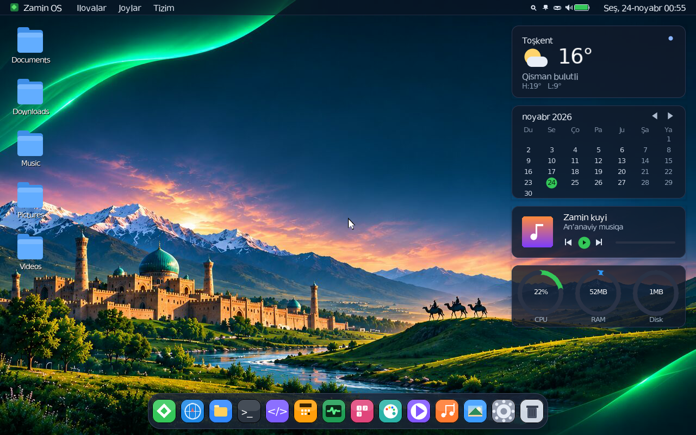

# Zamin OS ni VPS ga örnatiş (Netcup ARM)

Bu papkada Zamin OS ni ARM64 VPS da (masalan, **Netcup VPS 500 ARM G12**) **töğridan-töğri**
— Linux siz, öz yadrosi bilan — işga tuşiriş uçun vositalar bor.

| Fayl | Vazifasi |
|------|----------|
| `obraz.sh` | GPT disk obrazini yasaydi (ESP + Zamin maʼlumot bölimi) |
| `gpt.py` | obraz.sh yordamçisi: GPT jadvali (taşqi vositalarsiz) |
| `yoz.sh` | obrazni Rescue tizimidan diskka yozadi (ikki marta tasdiq söraydi) |
| `surat.py` | obrazni QEMU da yuklab, ekran suratini oladi (sinov uçun) |
| `tekshir.sh` | VPS ni tekşiradi (faqat öqiydi): arxitektura, UEFI, virtio, GIC |
| `ornat.sh` | **muqobil yöl**: Debian/Ubuntu VPS ustida QEMU içida işlatiş |

## 1. Obraz tuzilmasi

```
LBA 0          himoya MBR (0xEE)
LBA 1..33      GPT sarlavhasi + bölimlar jadvali
1-bölim        ESP, FAT32, 64 MiB:  EFI/BOOT/BOOTAA64.EFI  (Zamin OS yadrosi, UEFI ilovasi)
2-bölim        Zamin maʼlumot bölimi (tur GUID 7A616D69-6E00-4F53-9A4D-494E44534B31)
oxirgi 33      zaxira GPT
```

- UEFI firmware (EDK2/AAVMF) ESP dagi `\EFI\BOOT\BOOTAA64.EFI` ni "olinadigan disk" yöli
  bilan özi topadi — NVRAM da yozuv yaratiş şart emas.
- Yadro yuklanganda diskning GPT sini öqiydi (sarlavha va jadval CRC32 lari tekşiriladi),
  Zamin bölimini topadi va **sozlamalar, hisoblar hamda şifrlangan ZaminFS** ni faqat şu
  bölim içiga yozadi. Jurnalda: `[disk] GPT: Zamin bölimi #2 (LBA 133120 dan) — tizim diski`.
- Zamin bölimisiz boşqa GPT disklarga (masalan, Linux tizim diski) yadro **heç qaçon yozmaydi**.

## 2. Obrazni yasaş

```bash
scripts/vps/obraz.sh --release --xz          # → target/zamin-vps.img (2 GiB), .img.xz, .sha256
scripts/vps/obraz.sh --hajm 4G mening.img    # boşqa hajm / nom
```

Faqat Python standart kutubxonasi kerak (mtools, mkfs, sgdisk shart emas). Fayl siyrak:
2 GiB obraz diskda ~66 MiB joy oladi, `.xz` esa ~2 MiB.

## 3. Mahalliy sinov (QEMU, Netcup ga öxşaş muhit)

```bash
qemu-system-aarch64 -machine virt,gic-version=3 -cpu max -m 1G -smp 2 \
    -bios /usr/share/qemu-efi-aarch64/QEMU_EFI.fd \
    -drive file=target/zamin-vps.img,if=none,format=raw,id=d -device virtio-blk-pci,drive=d \
    -nic user,model=virtio-net-pci -device virtio-gpu-pci \
    -device virtio-keyboard-pci -device virtio-tablet-pci -device virtio-rng-pci -serial stdio
```

`QEMU_EFI.fd` bölmasa — AAVMF pflash: `-drive if=pflash,format=raw,readonly=on,file=/usr/share/AAVMF/AAVMF_CODE.fd
-drive if=pflash,format=raw,file=vars.fd` (`vars.fd` — `AAVMF_VARS.fd` nusxasi).

Avtomatik sinov: `scripts/agent/verify.sh obraz` — obrazni yasaydi, ikki marta yuklaydi
(GPT bölimi, grafik ekran, DHCP, sozlaş ustasi → sozlamalar bölimga yoziladi, MBR/GPT/ESP
butunligi tekşiriladi → qayta yuklanişda diskdan öqiladi). `verify.sh full` ham uni işlatadi.



## 4. Netcup ga örnatiş

> **Diqqat:** ikkala usul ham VPS diskidagi **hamma narsani öçiradi** (oldingi Linux,
> fayllar). Muhim maʼlumotlarni oldindan saqlab qöying. Netcup Server Control Panel (SCP)
> menyu nomlari panel versiyasiga qarab biroz farq qilişi mumkin.

### A usul — Rescue tizimi orqali `dd` (tavsiya etiladi)

1. SCP → serveringiz → **Media** → **Rescue System** → yoqing. Panel bergan root parolini
   saqlang; server Rescue (Debian live) bilan qayta yuklanadi.
2. SSH bilan kiring: `ssh root@<IP>`.
3. Diskni aniqlang: `lsblk` — odatda `/dev/vda` (virtio disk). Rescue tizimi uni **ulamaydi**.
4. Skript va obrazni oling, keyin **özingiz** işga tuşiring:

   ```bash
   curl -fsSLO https://raw.githubusercontent.com/abbosjon-dev/os/main/scripts/vps/yoz.sh
   bash yoz.sh https://<obraz manzili>/zamin-vps.img.xz /dev/vda
   # yoki obrazni scp bilan yuklab:  bash yoz.sh zamin-vps.img.xz /dev/vda --sha256 <summa>
   ```

   Skript: obraz GPT ekanini, diskning hajmini va ulanmaganini tekşiradi, `lsblk` ni
   körsatadi va **ikki marta tasdiq** söraydi (disk nomini qayta yoziş + katta harflar
   bilan `HA`). Keyin `dd` bilan yozadi, zaxira GPT ni disk oxiriga köçiradi va Zamin
   bölimini butun diskka kengaytiradi (`--kengaytirma` — kengaytirmaslik).
5. SCP → Media → Rescue System ni öçiring va serverni qayta yoqing (yoki `reboot`).
6. SCP → **Screen** (VNC konsoli): Zamin OS ekrani. Birinçi yuklanişda til, ism, login va
   parol sozlanadi; tarmoq DHCP orqali avtomatik sozlanadi.

### B usul — panel orqali öz obrazini yuklaş

Agar SCP da **Media → Images** (öz obrazlarini yuklaş, odatda FTP orqali) mavjud bölsa:

1. `target/zamin-vps.img` (raw) faylini panel körsatgan FTP manzilga yuklang.
2. Media → Images röyxatidan obrazni tanlab, diskka yozdiring (server öçiriladi).
3. Serverni yoqing, ekran — SCP → Screen.

Bu usulda Zamin bölimi obraz hajmiça (2 GiB) qoladi — kattaroq kerak bölsa, `obraz.sh
--hajm 20G` bilan yasang yoki A usuldan foydalaning.

### Muammo bölsa

- Ekran qora / `BdsDxe: failed to load` — obraz diskka töliq yozilganini tekşiring
  (`yoz.sh` dagi SHA-256 tekşiruvi), Rescue öçirilganini tasdiqlang.
- Jurnal: seriya konsol (`PL011`) — QEMU sinovida `-serial stdio`.
- Ortga qaytiş: SCP → Media → **Images** dan istalgan rasmiy Linux obrazini qayta örnating.

## 5. Muqobil: Linux ustida (ornat.sh)

Disk öçirilişini istamasangiz: `ornat.sh` mavjud Debian/Ubuntu VPS ga QEMU örnatib, Zamin
OS ni uning içida xizmat sifatida işlatadi, ekran esa brauzerda (noVNC) oçiladi. Faylning
boşidagi izohga qarang.
